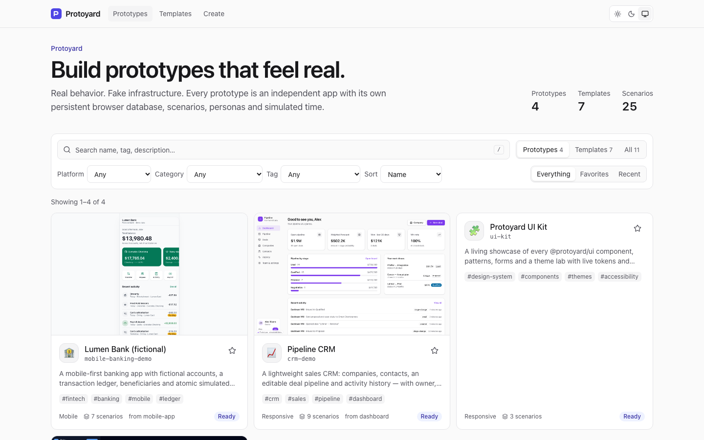
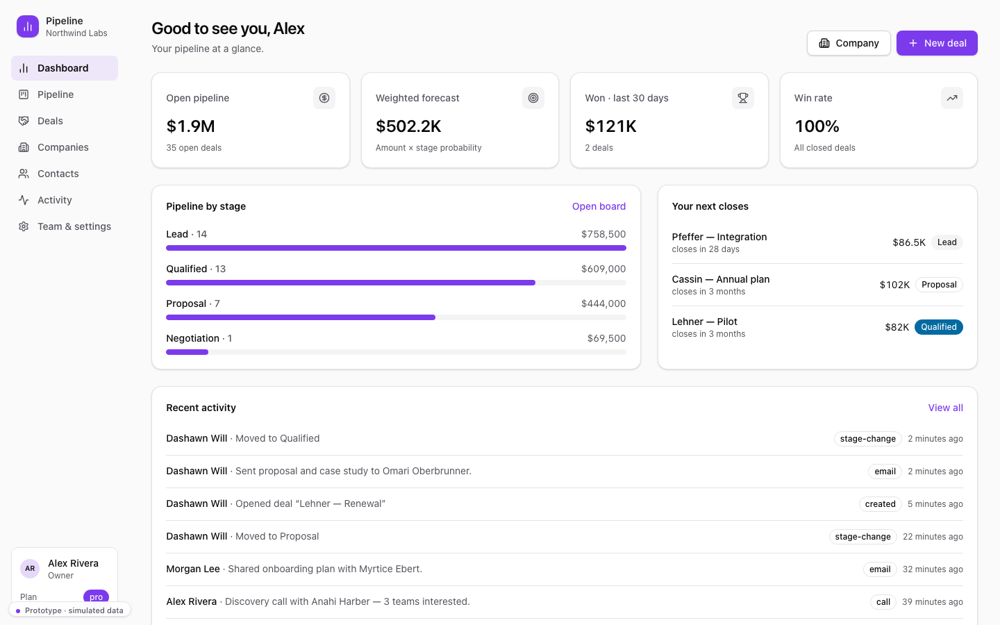
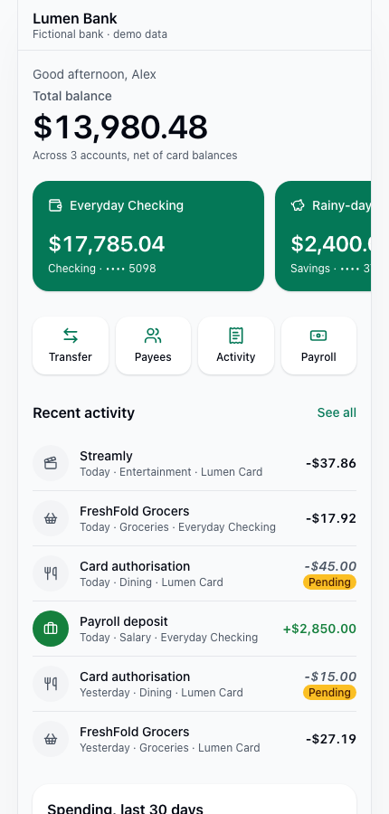
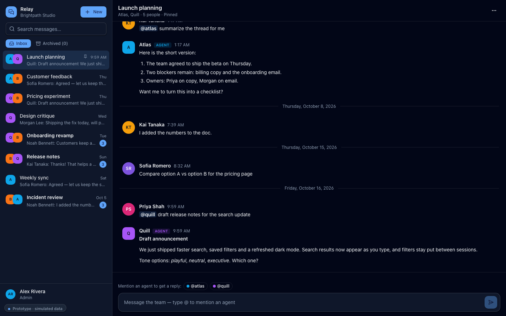
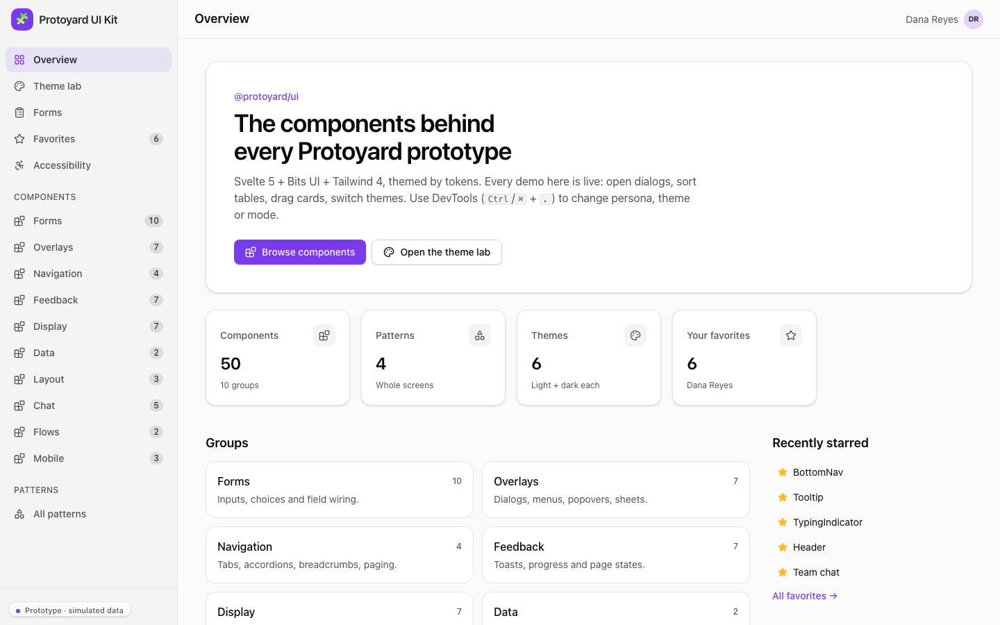

<div align="center">

# Protoyard

### Build prototypes that feel real.

**Real behavior. Fake infrastructure.**
An open-source, browser-first workspace for building, simulating, testing and
publishing interactive prototypes that behave like real products, with no
backend.

[Quickstart](docs/QUICKSTART.md) ·
[Agent guide](docs/AGENT_GUIDE.md) ·
[Architecture](docs/ARCHITECTURE.md) ·
[Scenarios](docs/SCENARIOS.md) ·
[Publishing](docs/PUBLISHING.md)



</div>

## Why

Mockups can't tell you what your product looks like **for a brand-new user,
for an admin six months in, with a thousand records, offline, or after the
trial expires**. Real apps can, but they need a backend, auth and a
deployment before you've validated the idea.

Protoyard sits in between. Every prototype is a small Svelte app with a
**real database in the browser**, **deterministic scenarios**, **personas
and permissions**, **simulated time and network**, **themes** and
**snapshots**. You can explore it, break it, reset it and publish it as a
static site. It was designed to be built by coding agents as much as by
people.

## Features

| | |
| --- | --- |
| 🗄️ **Persistent fake database** | IndexedDB via Dexie: typed tables, migrations, transactions, live queries. Changes survive reloads. Each prototype gets its own namespace. 16k-row worlds load in about 0.6 s with no UI stalls. |
| 🎬 **Scenario engine** | Compose actor, organization age, tenure, data density, activity, subscription and environment. The same seed rebuilds the same world. |
| 👥 **Personas and permissions** | Switch owner / admin / member / viewer (or custom roles) without losing data. Policies are enforced in services, not just hidden in the UI. *(Simulated UX, not security.)* |
| ⏱️ **Time travel** | Preview any date, or commit simulated days of activity. Idempotent: 7×1 day equals 1×7 days. |
| 🌐 **Environment simulator** | Offline, slow network, latency, reproducible 500/403/429/timeouts, partial outages, feature flags. |
| 🧪 **Sandboxed worlds** | `?sandbox=<name>` opens a disposable copy of a prototype's databases, so two scenarios can run side by side on one origin. |
| 🔌 **Mock HTTP (optional)** | `@protoyard/http` exposes your services as a `fetch`-compatible API with real status codes, simulated latency and outages, and a DevTools network log. No server and no service worker. |
| 📸 **Snapshots** | Save the exact world after your edits, restore it, export it to a file, import it with validation. |
| 🎨 **Themes** | Six AA-checked presets × light/dark/system, reduced motion, density, custom themes, no flash on load. Each prototype is styled independently. |
| 🧰 **DevTools** | A floating in-browser control center for scenario, personas, time, data, environment, appearance, snapshots and share links. Left out of public builds by default. |
| 🧩 **UI kit** | Svelte 5 + Bits UI + Tailwind 4 components and product patterns (data table, kanban, chat, wizard, mobile shell…). |
| 📦 **One-command export** | Static `dist/` + ZIP + build manifest with checksums. Relocatable base path and hash routing, so it runs on any static host. |
| 🚀 **Publishing** | Cloudflare Pages adapter with a true `--dry-run`. Netlify and Vercel adapters are experimental. `pnpm build:showcase` builds the gallery and every live demo as one static site (GitHub Pages workflow included, manual dispatch only). |
| 🤖 **Agent-first** | `AGENTS.md`, a CLI with `--json` on every command, templates, and a Deep Work Plan harness for long tasks. |

## 60-second start

```bash
git clone https://github.com/DailybotHQ/protoyard
cd protoyard
corepack enable && pnpm install
pnpm dev                          # gallery + local control server
```

Open the gallery, pick **Pipeline CRM**, and press `Ctrl/⌘ + .` inside the
prototype to open DevTools. Load "Brand-new signup", switch to the viewer
persona, go offline, save a snapshot.

```bash
pnpm protoyard new my-idea --template dashboard   # your own prototype
pnpm protoyard dev my-idea                         # only that app, with HMR
pnpm protoyard export my-idea                      # → artifacts/my-idea/my-idea.zip
```

## Demos (all fictional data)

| | Prototype | Shows |
| --- | --- | --- |
|  | **Pipeline CRM** · `crm-demo` | Desktop SaaS: companies, contacts, accessible kanban pipeline, activity history, owner/admin/rep/viewer roles with per-record rules, a v1→v2 migration, 9 scenarios including an enterprise-scale world. |
|  | **Lumen Bank** · `mobile-banking-demo` | Mobile-first: integer-cent ledger, atomic transfers that roll back on failure, payees, locked and dormant accounts, member transfer caps, offline. |
|  | **Relay** · `ai-chat-demo` | Team chat with scripted AI agents: streamed replies, cancel and retry, partial outages, unread state, a 600-message thread. No AI API. |
|  | **UI Kit** · `ui-kit` | Every component in every state, plus a theme lab with live tokens and contrast. |

## Templates

`blank` · `dashboard` · `mobile-app` · `chat` · `onboarding` ·
`task-manager` · `ecommerce`. Each one is a working app with a database,
roles, scenarios and tests, not a screenshot. See
`pnpm protoyard list --kind template`.

## Ask an agent

Give any coding agent prompts like these (it reads [AGENTS.md](AGENTS.md)):

> Create a new Protoyard prototype called `clinic-scheduler` from the
> dashboard template: patients, practitioners and appointments with
> conflict checks; receptionist, practitioner and viewer roles; scenarios
> for a new clinic, a busy month and a fully booked week; light and dark
> themes. Make every action persistent, add generator and service tests,
> then validate and export it. Don't touch other prototypes.

> Make a variant of `mobile-banking-demo` as a new prototype
> `teen-banking` with a completely different theme, savings goals and
> parental approval for transfers over $50. Keep the original untouched.

More prompts and the full loop are in [docs/AGENT_GUIDE.md](docs/AGENT_GUIDE.md).

## How it works

```text
packages/core ─ contracts (zod)          prototypes/<slug>/  ← independent Vite + Svelte 5 apps
packages/database ─ Dexie/IndexedDB        protoyard.json      data-only manifest (indexed, never executed)
packages/scenarios ─ seeded generators     src/prototype.ts    schema + policy + scenarios + generator
packages/runtime ─ the engine              src/domain/         services: assert → validate → simulate → transact
packages/renderer-svelte ─ mount + Vite    src/screens/        UI with @protoyard/ui
packages/ui · devtools · themes          apps/gallery ─ Astro, reads only the metadata registry
packages/cli ─ index · new · dev · validate · build · export · preview · publish
```

The gallery never compiles prototypes. Every CLI command targets one slug,
and builds contain only that prototype's code. Indexing 1,000 manifests is
measured in [docs/PERFORMANCE.md](docs/PERFORMANCE.md). Read
[ARCHITECTURE.md](docs/ARCHITECTURE.md) and [DECISIONS.md](docs/DECISIONS.md).

## Honest boundaries

- Data lives in **your browser, per origin**. It doesn't sync between
  devices, and the browser may clear it, so export snapshots of anything you
  want to keep.
- Personas and roles **simulate** product behavior. They are not security,
  and prototypes on the same origin can read each other's storage.
- Mobile prototypes run in the **mobile browser**. There is no native runtime.
- Demo data is fictional. Nothing connects to real banks, payments or AI
  services.

## Commands

```bash
pnpm dev | build | lint | typecheck | test | test:e2e | check
pnpm protoyard help | doctor | list | index | new | dev | validate | build | export | preview | publish
```

Full reference: [docs/DEVELOPMENT_COMMANDS.md](docs/DEVELOPMENT_COMMANDS.md).

## Quality

- 450+ unit and integration tests, most of them on the real runtime with an
  in-memory IndexedDB.
- Playwright E2E on real static builds, on desktop and a Pixel 7 viewport.
- Biome, strict erasable TypeScript, `svelte-check` and `astro check` in CI.
- A public-hygiene check for secrets and stray files.
- Every theme is AA-contrast tested.
- An internal security review of the CLI, the local control server,
  snapshot import and publishing, with regression tests that reproduce the
  fixed findings (for example
  [packages/cli/tests/security.test.ts](packages/cli/tests/security.test.ts);
  threat model in [docs/SECURITY.md](docs/SECURITY.md)).
- Performance numbers are measured, not estimated
  ([docs/PERFORMANCE.md](docs/PERFORMANCE.md)).

## Contributing

Contributions are welcome. Read [CONTRIBUTING.md](CONTRIBUTING.md),
[AGENTS.md](AGENTS.md) and the [Code of Conduct](CODE_OF_CONDUCT.md). Report
vulnerabilities privately ([SECURITY.md](SECURITY.md)). The repository runs
on the [Deep Work Plan](https://deepworkplan.com) methodology: long work is
planned and executed as verifiable plans in `.dwp/`.

## License

[MIT](LICENSE) © Dailybot, Inc.
