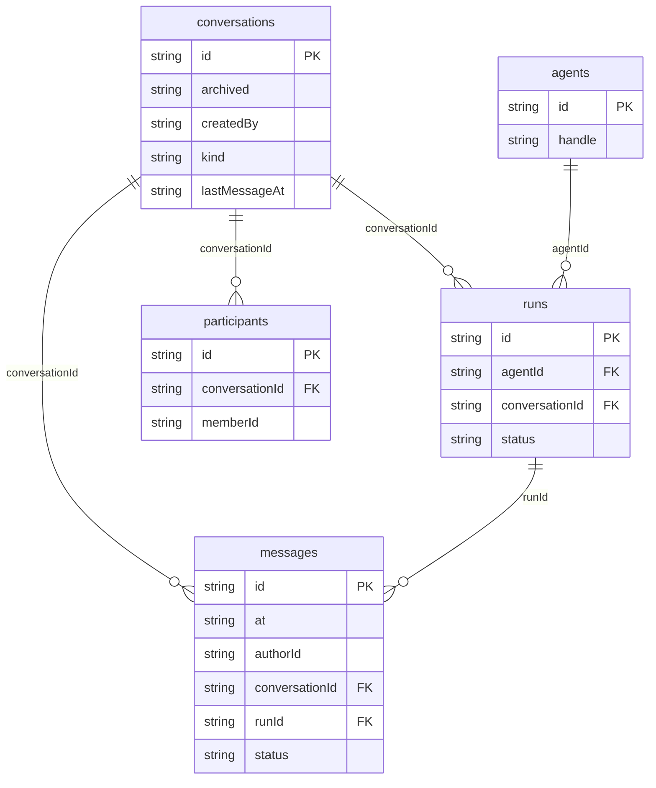

# Relay — team AI chat: data model

## Overview

Relay is a team chat where people and AI agents post in the same threads.
People are the platform personas (`py_personas`, a reserved platform table);
the three scripted agents (Atlas, Quill, Beacon) are rows in `agents`. Both
kinds can author a message, so `messages.authorId` points at either, with
`authorKind` saying which.

A `conversations` row is joined to its people and agents through
`participants`, which also stores each member's `lastReadAt`: unread counts
are the messages after that instant not written by that person. An agent
reply is a **run** (`runs`) that streams into one `messages` row: the row is
created empty with status `streaming` and its body grows chunk by chunk, so a
reload shows exactly what had arrived. Messages are read in order through the
compound index `[conversationId+at]`.

## Tables

<!-- protoyard:generated:tables -->
| Table | Primary key | Indexes |
| --- | --- | --- |
| `agents` | `id` (unique) | `handle` |
| `conversations` | `id` (unique) | `archived`, `createdBy`, `kind`, `lastMessageAt` |
| `messages` | `id` (unique) | `[conversationId+at]` (compound), `at`, `authorId`, `conversationId`, `runId`, `status` |
| `participants` | `id` (unique) | `[conversationId+memberId]` (compound), `conversationId`, `memberId` |
| `runs` | `id` (unique) | `agentId`, `conversationId`, `status` |
<!-- /protoyard:generated:tables -->

## Diagram

<!-- protoyard:generated:er-diagram -->

_Indexed fields only. Relations are inferred from indexed `…Id` fields that match a table name; describe the rest by hand._
<!-- /protoyard:generated:er-diagram -->

## Relations

| From | To | Cardinality | Notes |
| --- | --- | --- | --- |
| `conversations.createdBy` | `py_personas.id` | many to one | Checked by the prototype's integrity rules; drives the member rule in [PERMISSIONS.md](PERMISSIONS.md) |
| `participants.memberId` | `py_personas.id` or `agents.id` | many to one | `memberKind` (`person` or `agent`) says which table |
| `messages.authorId` | `py_personas.id` or `agents.id` | many to one | `authorKind` says which. A removed person shows as "Former member". |
| `messages.runId` | `runs.id` | zero or one per message | Set only on agent replies created by a run. Generated history has `runId: null`. A retry deletes the reply, so a run can end with no message. |
| `runs.promptMessageId` | `messages.id` | many to one | The person's message the run answers (several agents can answer one prompt) |
| `runs.agentId` | `agents.id` | many to one | |
| `participants.conversationId`, `messages.conversationId`, `runs.conversationId` | `conversations.id` | many to one | Deleting a conversation deletes all three in one transaction |

There is at most one participant row per `[conversationId+memberId]` in
practice (`createConversation` deduplicates people), but the index is not
unique.

## Field notes

- **Dates:** every timestamp (`createdAt`, `lastMessageAt`, `lastReadAt`,
  `at`, `startedAt`, `finishedAt`) is an ISO 8601 string from the simulation
  clock, never wall-clock time. `finishedAt` is `null` while a run streams.
- **`conversations.kind`:** `channel` or `direct`. A new conversation is
  `direct` when its agents plus invited teammates number one or fewer.
  Generated conversations are all `channel`. The UI does not read it today.
- **`conversations.pinned`, `archived`:** booleans on the conversation, so
  shared by every persona. Archived conversations reject `send` and `retry`.
- **`conversations.title`:** trimmed, 2 to 60 characters.
- **`participants.memberKind`, `messages.authorKind`:** `person` or `agent`.
- **`messages.status`:** `sent`, `streaming` (an agent reply being written,
  or one cut off by a reload) or `failed` (the body holds the error text).
- **`messages.body`:** trimmed, 1 to 4,000 characters for people. Agent
  bodies use a small, safe Markdown subset rendered as elements.
- **`messages.at`:** always after the conversation's previous latest message
  (the clock can be frozen), so concurrent replies get distinct, ordered
  instants.
- **`runs.status`:** `streaming`, `done`, `error` (with `error` text) or
  `cancelled`. `runs.tokens` is a simulated count, `ceil(characters / 4)`.
- **`agents.speed`** (simulated tokens per second) and **`agents.skills`** are
  descriptive data; streaming pace does not use them (chunks are written
  about every 45 ms).
- **Ids** come from the scenario generator (`conv`, `msg`, `part` prefixes)
  or `createRuntimeId` at run time. Agent ids are fixed: `agent_atlas`,
  `agent_quill`, `agent_ops` (handle `beacon`).
- Seeded worlds have an empty `runs` table: history replies are plain
  messages with `runId: null`.

## Schema history

<!-- protoyard:generated:versions -->
| Version | Adds | Changes indexes | Deletes |
| --- | --- | --- | --- |
| 1 | `agents`, `conversations`, `messages`, `participants`, `runs` | — | — |
<!-- /protoyard:generated:versions -->

## Migrations

None. Version 1 is the only schema version and has no `upgrade` function.
A change to the stores needs a new version in `src/database/schema.ts`; a
change to generated output needs a bump of `CHAT_GENERATOR_VERSION`.
