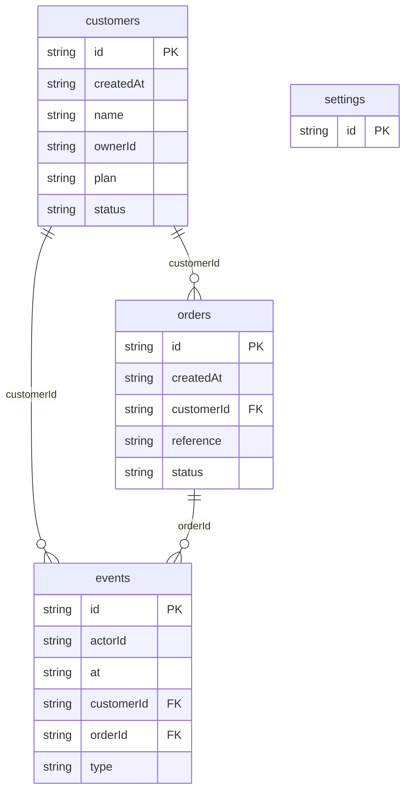

# Atlas Workspace Demo: data model

## Overview

The workspace stores fictional customers, their orders, an append-only operational event history and one workspace settings record. Events are written with the mutation they describe so the UI can show an auditable local history.

## Tables

<!-- protoyard:generated:tables -->
| Table | Primary key | Indexes |
| --- | --- | --- |
| `customers` | `id` (unique) | `createdAt`, `name`, `ownerId`, `plan`, `status` |
| `events` | `id` (unique) | `actorId`, `at`, `customerId`, `orderId`, `type` |
| `orders` | `id` (unique) | `createdAt`, `customerId`, `reference`, `status` |
| `settings` | `id` (unique) | — |
<!-- /protoyard:generated:tables -->

## Diagram

<!-- protoyard:generated:er-diagram -->

_Indexed fields only. Relations are inferred from indexed `…Id` fields that match a table name; describe the rest by hand._
<!-- /protoyard:generated:er-diagram -->

## Relations

Each customer can own many orders. Events may reference a customer and/or order; deleting a customer removes its dependent orders and history before writing a non-referencing deletion event. Customer ownership, event actors and settings editors reference prototype personas.

## Field notes

Order amounts use integer cents. Dates are ISO strings driven by simulated time. Customer status, plan, currency and order status are finite schema unions; order transitions are validated by the service layer.

## Schema history

<!-- protoyard:generated:versions -->
| Version | Adds | Changes indexes | Deletes |
| --- | --- | --- | --- |
| 1 | `customers`, `events`, `orders`, `settings` | — | — |
| 2 | — | — | — |
<!-- /protoyard:generated:versions -->

## Migrations

Version 2 converts any legacy numeric `orders.amount` value to rounded integer `amountCents` and removes the old field. Existing version-2 databases do not need another upgrade.
