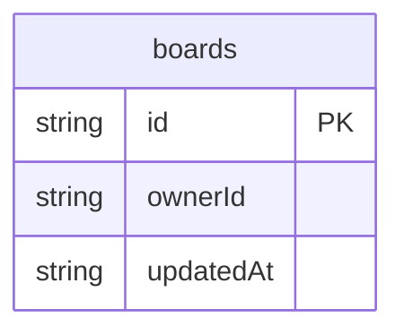

# Canvas Board Demo: data model

## Overview

A workspace holds boards. Each board is one row whose `canvas` field is a
whole Texuli canvas document (`CanvasDocument`): its shapes, frames and
connectors. The canvas is stored as one document because the editor saves
the whole canvas after each change.

## Tables

<!-- protoyard:generated:tables -->
| Table | Primary key | Indexes |
| --- | --- | --- |
| `boards` | `id` (unique) | `ownerId`, `updatedAt` |
<!-- /protoyard:generated:tables -->

## Diagram

<!-- protoyard:generated:er-diagram -->

_Indexed fields only. Relations are inferred from indexed `…Id` fields that match a table name; describe the rest by hand._
<!-- /protoyard:generated:er-diagram -->

## Relations

`boards.ownerId` → a persona id (`user_0001` in the scenarios); there is no
people table.

## Field notes

- `createdAt` and `updatedAt` are ISO dates; `updatedAt` changes on every save.
- `title` is 1 to 80 characters and is also the canvas's `meta.title`.
- `canvas` always passes `validateCanvas`: the services refuse anything else.

## Schema history

<!-- protoyard:generated:versions -->
| Version | Adds | Changes indexes | Deletes |
| --- | --- | --- | --- |
| 1 | `boards` | — | — |
<!-- /protoyard:generated:versions -->

## Migrations

None yet: version 1 is the first schema.
