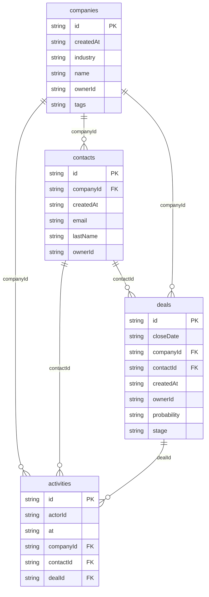

# Pipeline CRM: data model

## Overview

A workspace sells to **companies**. Each company has **contacts** (people)
and **deals** (opportunities). A deal moves through six stages
(`lead` → `qualified` → `proposal` → `negotiation` → `won` or `lost`) and may
name one primary contact. **Activities** are the history: notes, calls,
emails and meetings people log, plus `created` and `stage-change` entries
the services write in the same transaction as the change they describe.

The model is flat and keyed by string ids so every screen can be a
`liveQuery` over one or two tables. Indexes exist for the lookups the
screens and services do: by company (detail pages and the delete cascade),
by owner, by stage and probability (pipeline and forecast), by close date,
and by `at` for the newest-first activity feed. Workspace identity
(organization, personas, memberships) lives in the reserved platform tables
(`py_organizations`, `py_memberships`, `py_personas`), not in this schema.

Seeded ids are deterministic (`deal_0007`); ids created in the UI come from
`createRuntimeId` and carry a `u` marker.

## Tables

<!-- protoyard:generated:tables -->
| Table | Primary key | Indexes |
| --- | --- | --- |
| `activities` | `id` (unique) | `actorId`, `at`, `companyId`, `contactId`, `dealId` |
| `companies` | `id` (unique) | `createdAt`, `industry`, `name`, `ownerId`, `tags` (multi-entry) |
| `contacts` | `id` (unique) | `companyId`, `createdAt`, `email`, `lastName`, `ownerId` |
| `deals` | `id` (unique) | `closeDate`, `companyId`, `contactId`, `createdAt`, `ownerId`, `probability`, `stage` |
<!-- /protoyard:generated:tables -->

## Diagram

<!-- protoyard:generated:er-diagram -->


_Indexed fields only. Relations are inferred from indexed `…Id` fields that match a table name; describe the rest by hand._
<!-- /protoyard:generated:er-diagram -->

## Relations

```text
py_organizations ─┬─ py_memberships ── py_personas      (platform identity tables)
                  │
companies 1─* contacts
companies 1─* deals *─1 contacts (optional)
activities → deal | company | contact, actorId → py_personas
```

| From | Field | To | Cardinality | Notes |
| --- | --- | --- | --- | --- |
| `contacts` | `companyId` | `companies` | many to one, required | `contacts.create` rejects a company that no longer exists |
| `deals` | `companyId` | `companies` | many to one, required | `deals.create` rejects a missing company |
| `deals` | `contactId` | `contacts` | many to zero-or-one | `null` when the deal has no primary contact |
| `activities` | `dealId`, `companyId`, `contactId` | `deals`, `companies`, `contacts` | many to zero-or-one each | All nullable; an activity points at whichever records it is about |
| `companies`, `contacts`, `deals` | `ownerId` | `py_personas` | many to one | The persona who created the record (deals may be assigned to another persona) |
| `activities` | `actorId` | `py_personas` | many to one | Who did it |

These relations are also declared as `integrity.relations` in
`src/prototype.ts`, so generated worlds are checked for dangling
references.

Delete behavior (in `src/domain/services.ts`, not enforced by the
database):

- Deleting a **company** deletes its contacts, its deals, every activity with
  that `companyId` and every activity of those deals, in one transaction.
- Deleting a **deal** deletes the activities with that `dealId`.
- Deleting a **contact** sets `contactId` to `null` on deals that named it.
  Activities that reference the contact are not changed, so their
  `contactId` can point at a deleted row.

## Field notes

- **Money:** `deals.amount` is a whole number of **US dollars** (not
  cents), rounded with `Math.round` on create and update, between 0 and
  100,000,000. `deals.currency` is always `'USD'`. Generated amounts are
  multiples of 500 between 2,000 and 120,000. This differs from the
  repository's integer-cents convention; a real rebuild should decide which
  unit to keep.
- **Dates:** every timestamp (`createdAt`, `updatedAt`, `closeDate`,
  `closedAt`, `activities.at`) is an ISO 8601 string from the simulated
  clock. `closeDate` comes from a date input and is stored as the ISO
  instant of that date.
- **`deals.stage`:** `lead`, `qualified`, `proposal`, `negotiation`, `won`,
  `lost` (`DEAL_STAGES`). The first four are open (`OPEN_STAGES`).
- **`deals.probability`:** a percentage set from the stage on every stage
  change (`STAGE_PROBABILITY`: lead 10, qualified 25, proposal 50,
  negotiation 75, won 100, lost 0). It is not edited directly.
- **`deals.lostReason`:** a string only while the stage is `lost`
  (`'No reason given'` when none is supplied; the timeline uses
  `'No decision'`), otherwise `null`.
- **`deals.closedAt`:** set to the simulated now when a deal reaches `won`
  or `lost`, cleared to `null` when it reopens. Optional because rows
  stored before generator v3 lack it; readers fall back to `updatedAt`.
- **`activities.type`:** `note`, `call`, `email`, `meeting`, `stage-change`,
  `created`. People can log only the first four; services write `created`
  and `stage-change`. `body` is 2–2,000 characters for logged activities.
- **`companies.industry`:** one of `Software`, `Healthcare`, `Logistics`,
  `Education`, `Retail`, `Manufacturing`, `Finance`, `Media` in the UI
  (`INDUSTRIES`); the service accepts any non-empty string.
- **`companies.domain`:** lowercase, must match `name.tld` (for example
  `acme.example`). **`companies.tags`:** up to 8 tags of 1–24 characters,
  indexed multi-entry. **`companies.employees`:** integer 1–1,000,000.
- **`contacts.email`:** lowercased and validated as an email; the UI asks
  for `example.com` addresses.

## Schema history

<!-- protoyard:generated:versions -->
| Version | Adds | Changes indexes | Deletes |
| --- | --- | --- | --- |
| 1 | `activities`, `companies`, `contacts`, `deals` | — | — |
| 2 | — | `companies`, `deals` | — |
<!-- /protoyard:generated:versions -->

## Migrations

- **v1** creates `companies`, `contacts`, `deals` and `activities`. No
  upgrade function.
- **v2** adds an index on `deals.probability` (forecast sorting) and a
  multi-entry index on `companies.tags`. Its `upgrade` modifies existing
  rows in place: every deal without a numeric `probability` gets
  `STAGE_PROBABILITY[stage]` (0 for an unknown stage), and every company
  whose `tags` is not an array gets `[]`. Nothing is deleted. It is the
  reference example for migrations in this repository.

`storage.schemaVersion` in `protoyard.json` is 2 and must match the latest
entry of `database.versions`.
