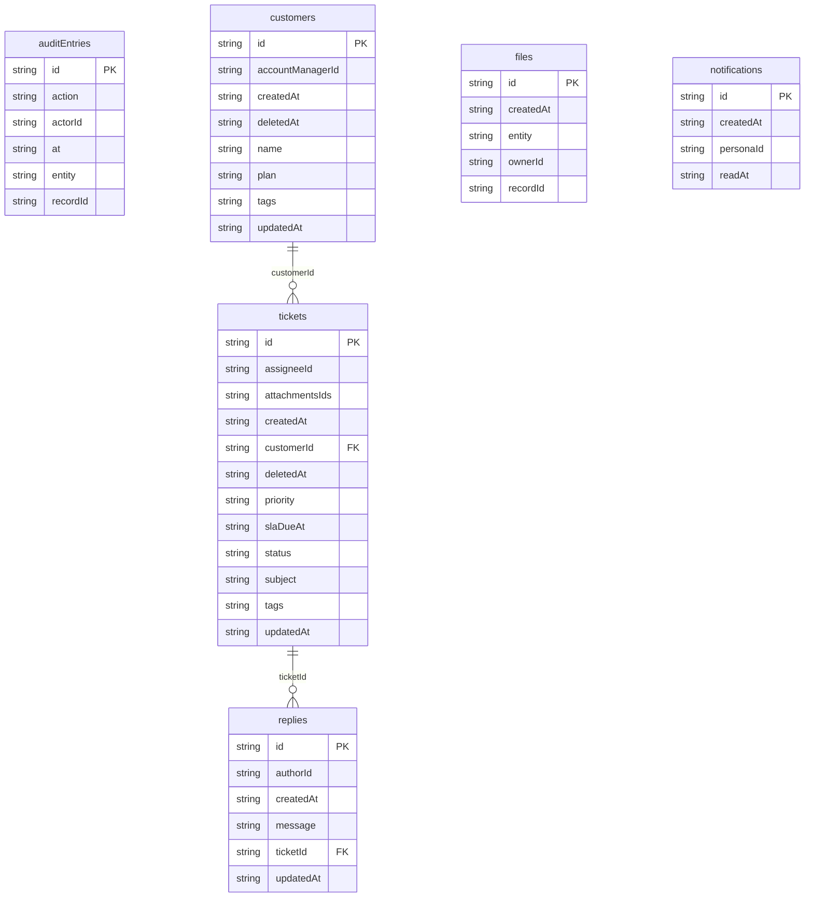

# Beacon Help Desk: data model

## Overview

A support desk serves **customers**. Each customer has **tickets**
(conversations about one problem), and each ticket has a thread of
**replies**: messages to the customer or internal notes for the team. Tickets
carry the working state of the desk: status, priority, channel, the SLA due
time, an assignee and file attachments.

The model is not hand-written. `src/database/schema.ts` re-exports
`src/generated/schema.ts`, which calls `deriveDatabaseVersions(blueprint)`:
every store string is derived from the entity fields in
[blueprint.json](../blueprint.json). Relation, persona, tag and file fields
always get an index (`customerId`, `assigneeId`, `*tags`, `*attachmentsIds`);
scalar fields are indexed only when the blueprint lists them in `indexes`,
`titleField` or `defaultSort` (so `status`, `priority`, `slaDueAt`, `subject`,
`name`, `plan`, `message`). Entities with soft delete (`customers`,
`tickets`) get a `deletedAt` index.

Three feature tables come from the blueprint `features` flags, not from
entities: `auditEntries` (change history, `audit: true` on all three
entities), `files` (attachments, `files: true` on tickets) and
`notifications` (the notification rules). Workspace identity lives in the
reserved platform tables (`py_organizations`, `py_memberships`,
`py_personas`), not in this schema.

Seeded ids are deterministic (`ticket_0007`); ids created in the UI come from
`createRuntimeId` and carry a `u` marker.

## Tables

<!-- protoyard:generated:tables -->
| Table | Primary key | Indexes |
| --- | --- | --- |
| `auditEntries` | `id` (unique) | `action`, `actorId`, `at`, `entity`, `recordId` |
| `customers` | `id` (unique) | `accountManagerId`, `createdAt`, `deletedAt`, `name`, `plan`, `tags` (multi-entry), `updatedAt` |
| `files` | `id` (unique) | `createdAt`, `entity`, `ownerId`, `recordId` |
| `notifications` | `id` (unique) | `[personaId+readAt]` (compound), `createdAt`, `personaId`, `readAt` |
| `replies` | `id` (unique) | `authorId`, `createdAt`, `message`, `ticketId`, `updatedAt` |
| `tickets` | `id` (unique) | `assigneeId`, `attachmentsIds` (multi-entry), `createdAt`, `customerId`, `deletedAt`, `priority`, `slaDueAt`, `status`, `subject`, `tags` (multi-entry), `updatedAt` |
<!-- /protoyard:generated:tables -->

## Diagram

<!-- protoyard:generated:er-diagram -->


_Indexed fields only. Relations are inferred from indexed `…Id` fields that match a table name; describe the rest by hand._
<!-- /protoyard:generated:er-diagram -->

## Relations

```text
py_organizations ─┬─ py_memberships ── py_personas      (platform identity tables)
                  │
customers 1─* tickets 1─* replies
tickets *─* files (attachmentsIds)          files → (entity, recordId)
auditEntries → (entity, recordId), actorId → py_personas
notifications → personaId
```

| From | Field | To | Cardinality | Notes |
| --- | --- | --- | --- | --- |
| `tickets` | `customerId` | `customers` | many to one, required | `onDelete: cascade` in the blueprint; the service rejects missing and soft-deleted customers ("Customer not found") |
| `replies` | `ticketId` | `tickets` | many to one, required | `onDelete: cascade` |
| `customers` | `accountManagerId` | `py_personas` | many to zero-or-one | The blueprint `ownerField`; set to the acting persona on create when left blank |
| `tickets` | `assigneeId` | `py_personas` | many to zero-or-one | The `ownerField`; set to the acting persona on create when left blank. Seeded tickets are unassigned about 15% of the time |
| `replies` | `authorId` | `py_personas` | many to zero-or-one | The `ownerField`; set to the acting persona on create |
| `tickets` | `attachmentsIds` | `files` | many to many (array) | Multi-entry index; the file service appends the new id |
| `files` | `entity`, `recordId` | any entity table | many to one, polymorphic | Always `ticket` today |
| `files` | `ownerId` | `py_personas` | many to one | Who uploaded it |
| `auditEntries` | `entity`, `recordId` | any entity table | many to one, polymorphic | Kept when the record is deleted |
| `auditEntries` | `actorId` | `py_personas` | many to one | Who made the change |
| `notifications` | `personaId` | `py_personas` | many to one | The recipient |

These relations are also declared as integrity rules (`deriveIntegrity` in
`src/prototype.ts`), so generated worlds are checked for dangling references.

Delete behavior (in the generated services, not enforced by the database):

- **Single delete** of a customer or ticket is a soft delete: it sets
  `deletedAt`, `deletedBy` and `updatedAt` on the record and on every row the
  cascade reaches (a customer's tickets, and those tickets' replies), so they
  disappear from lists and can be restored with Undo. The token carries only
  the root id; trusted cascade and nullification data stays on the stored root.
- **Bulk delete** (`bulkRemove`) and **purge** are hard deletes: the record,
  its cascade and their attachment rows are removed in the same transaction.
- Deleting a reply is always a hard delete (replies have no soft delete).
- Soft-deleted attachments stay available while a record is in Trash; purging
  the record removes its attachment rows and frees their quota. Audit history
  is retained after deletion.

## Field notes

- **No money fields.** `customers.plan` is a label, not a price.
- **Dates:** `createdAt`, `updatedAt`, `deletedAt`, `slaDueAt`,
  `auditEntries.at`, `files.createdAt` and the notification timestamps are
  ISO 8601 strings from the simulated clock. The form edits `slaDueAt` with a
  `datetime-local` input and the service stores it as an ISO instant.
- **`tickets.status`:** `open`, `pending`, `on-hold`, `solved` (default
  `open`). The dashboard board uses this order, and a solved ticket's SLA
  counts as met.
- **`tickets.priority`:** `low`, `normal`, `high`, `urgent` (default
  `normal`). **`tickets.channel`:** `email`, `chat`, `phone` (default
  `email`).
- **`tickets.slaDueAt`:** in generated worlds, `createdAt` plus 4 h (urgent),
  8 h (high), 24 h (normal) or 72 h (low) (`SLA_HOURS` in
  `src/scenarios/helpdesk.ts`). It is a future instant by design, so it is
  left out of the "timestamps before the reference time" integrity rule.
  Services do not compute it: a ticket created or re-prioritized in the UI
  keeps whatever the form holds (blank means "No SLA").
- **`customers.plan`:** `free`, `pro`, `enterprise` (default `free`).
- **Text limits (zod, from the blueprint):** customer `name` 2–80
  characters; `email` a valid address, stored lowercased; ticket `subject`
  4–120; `description` up to 4,000; reply `message` 2–200. `tags`: up to 8
  tags of at most 32 characters, deduplicated.
- **`replies.internal`:** boolean, default `false`; `true` marks an internal
  note.
- **Soft delete:** `deletedAt` and `deletedBy` are `null` on live customers
  and tickets. A cascaded soft delete also writes them on `replies` rows,
  although replies have no soft-delete feature or `deletedAt` index; the
  reply list hides those rows.
- **`files`:** `name`, `type` (MIME), `size` in bytes, `ownerId`, `entity`,
  `recordId`, `createdAt`, and `blob` (the bytes as an `ArrayBuffer`). The
  ticket field accepts `image/*`, `application/pdf` and `text/plain` up to
  2,097,152 bytes (2 MB) each; all files together are limited to 50 MB per
  prototype (`DEFAULT_FILE_QUOTA_BYTES`).
- **`auditEntries`:** `action` is `create`, `update`, `delete`, `restore`,
  `purge` or `import`; `changes` maps each changed field to
  `{ before, after }` (timestamps and soft-delete markers are omitted);
  `seq` orders entries that share the same simulated `at`.
- **`notifications`:** `kind` is `ticket.create` or `ticket.assign` for rows
  the services write (`<entity>.create` with the title "Update on <entity>"
  and a `recordId` for seeded rows); `body` is empty; `readAt` is `null` while
  unread. The unread count is total minus the rows found through the
  `[personaId+readAt]` index, because IndexedDB does not index `null`.

## Schema history

<!-- protoyard:generated:versions -->
| Version | Adds | Changes indexes | Deletes |
| --- | --- | --- | --- |
| 1 | `auditEntries`, `customers`, `files`, `notifications`, `replies`, `tickets` | — | — |
<!-- /protoyard:generated:versions -->

## Migrations

- **v1** creates `customers`, `tickets`, `replies`, `auditEntries`, `files`
  and `notifications` from blueprint.json. No upgrade function.

blueprint.json has no `history` yet. When a regeneration changes storage,
`protoyard generate` appends a version (with data-only upgrade steps) from
that history, so existing browser data migrates instead of being reset.
`storage.schemaVersion` in `protoyard.json` is 1 and must match the latest
entry of `database.versions`.
