# Lattice: data model

## Overview

A visitor signs up for an **account**, which creates a persona and a
**workspace** (organization). Each workspace holds a portfolio of
**projects**; a project is a name, a summary and a status (`planning`,
`active`, `complete`). Everything else is the SaaS kit's state around that
domain: sign-in history, single-use tokens (verify email, magic link,
password reset, invitation, OAuth state), simulated MFA factors, workspace
invitations, the simulated inbox, subscriptions, invoices and the onboarding
wizard position.

`projects` is the only table this prototype defines itself. The ten
`saas_*` tables come from `saasStores(1)` in `@protoyard/saas` (their row
schemas, with defaults, are `SAAS_ROW_SCHEMAS` in
`packages/saas/src/schema.ts`; the
[kit README](../../../packages/saas/README.md) describes each one). Projects
are indexed by `organizationId` because every read and write is scoped to
the active workspace. Workspace identity (organizations, personas,
memberships) lives in the reserved platform tables (`py_organizations`,
`py_memberships`, `py_personas`), not in this schema; the kit writes them
through `runtime.identity.write`.

Seeded ids are deterministic (`project_0003`); ids created in the UI come
from `createRuntimeId` and carry a `u` marker (`project_u…`).

## Tables

<!-- protoyard:generated:tables -->
| Table | Primary key | Indexes |
| --- | --- | --- |
| `projects` | `id` (unique) | `createdAt`, `organizationId`, `ownerPersonaId`, `status` |
| `saas_accounts` | `id` (unique) | `email` (unique), `personaId` |
| `saas_inbox` | `id` (unique) | `at`, `kind`, `personaId`, `recipient` |
| `saas_invitations` | `id` (unique) | `email`, `organizationId`, `status`, `tokenId` |
| `saas_invoices` | `id` (unique) | `issuedAt`, `organizationId`, `subscriptionId` |
| `saas_mfa` | `id` (unique) | `accountId` (unique) |
| `saas_onboarding` | `id` (unique) | `organizationId`, `personaId` |
| `saas_sessions_log` | `id` (unique) | `accountId`, `at`, `personaId` |
| `saas_subscriptions` | `id` (unique) | `organizationId`, `status` |
| `saas_tokens` | `id` (unique) | `accountId`, `email`, `expiresAt`, `kind` |
<!-- /protoyard:generated:tables -->

## Diagram

```mermaid
erDiagram
  projects {
    string id PK
    string createdAt
    string organizationId
    string ownerPersonaId
    string status
  }
  saas_accounts {
    string id PK
    string email
    string personaId
  }
  saas_inbox {
    string id PK
    string at
    string kind
    string personaId
    string recipient
  }
  saas_invitations {
    string id PK
    string email
    string organizationId
    string status
    string tokenId
  }
  saas_invoices {
    string id PK
    string issuedAt
    string organizationId
    string subscriptionId
  }
  saas_mfa {
    string id PK
    string accountId
  }
  saas_onboarding {
    string id PK
    string organizationId
    string personaId
  }
  saas_sessions_log {
    string id PK
    string accountId
    string at
    string personaId
  }
  saas_subscriptions {
    string id PK
    string organizationId
    string status
  }
  saas_tokens {
    string id PK
    string accountId
    string email
    string expiresAt
    string kind
  }
```

<!-- protoyard:generated:er-diagram -->


_Indexed fields only. Relations are inferred from indexed `…Id` fields that match a table name; describe the rest by hand._
<!-- /protoyard:generated:er-diagram -->

## Relations

```text
py_organizations ─┬─ py_memberships ── py_personas      (platform identity tables)
                  │
                  ├─ projects (organizationId; ownerPersonaId → py_personas)
                  ├─ saas_subscriptions 1─* saas_invoices
                  └─ saas_invitations → saas_tokens
py_personas 1─1 saas_accounts 1─0..1 saas_mfa
saas_accounts 1─* saas_tokens, saas_sessions_log
saas_inbox → recipient email (personaId optional)
saas_onboarding: one row per persona
```

| From | Field | To | Cardinality | Notes |
| --- | --- | --- | --- | --- |
| `projects` | `organizationId` | `py_organizations` | many to one, required | Set from the active workspace on create; update and delete refuse a project of another workspace |
| `projects` | `ownerPersonaId` | `py_personas` | many to one, required | The persona who created it; never changed |
| `saas_accounts` | `personaId` | `py_personas` | one to one | `email` is unique |
| `saas_sessions_log` | `accountId`, `personaId` | `saas_accounts`, `py_personas` | many to zero-or-one each | Every sign-in, sign-up and sign-out attempt |
| `saas_tokens` | `accountId` | `saas_accounts` | many to zero-or-one | `null` for an invitation to someone without an account |
| `saas_mfa` | `accountId` | `saas_accounts` | zero-or-one to one | `accountId` is unique |
| `saas_invitations` | `organizationId`, `invitedBy`, `tokenId`, `acceptedBy` | `py_organizations`, `py_personas`, `saas_tokens`, `py_personas` | many to one each | `tokenId` becomes `null` when revoked |
| `saas_inbox` | `recipient`, `personaId` | an email address, `py_personas` | many to one | Messages are addressed by email so a signed-out address can receive them |
| `saas_subscriptions` | `organizationId` | `py_organizations` | many to one | At most one `trialing`, `active` or `past_due` subscription counts as current |
| `saas_invoices` | `organizationId`, `subscriptionId` | `py_organizations`, `saas_subscriptions` | many to one | `subscriptionId` is `null` for a failed or unconfirmed first checkout |
| `saas_onboarding` | `personaId`, `organizationId` | `py_personas`, `py_organizations` | one per persona | The row id is the persona id |

These relations are declared as integrity rules (`saasScenarioIntegrity()`
merged with the project rules in `src/prototype.ts`), so generated worlds
are checked for dangling references. Nothing cascades: deleting a project
removes only that row, and removing a member leaves their account, tokens
and inbox rows in place.

## Field notes

- **`projects.status`:** `planning`, `active`, `complete`
  (`PROJECT_STATUSES`); new projects default to `planning`.
- **`projects.name`:** 2–80 characters, trimmed. **`projects.summary`:** up
  to 240 characters, trimmed, `''` by default.
- **Seeded projects:** six per scenario, all in the primary workspace and
  owned by the scenario actor ("Website relaunch" and "Mobile experience
  refresh" active, "Q4 operating plan" complete, the other three planning),
  with a generated buzz-phrase summary. Extra workspaces from
  `multi-workspace-admin` have no projects.
- **Dates:** every timestamp (`createdAt`, `updatedAt`, `expiresAt`,
  `consumedAt`, `at`, `trialEndsAt`, `currentPeriodStart`/`End`,
  `issuedAt`, `paidAt`) is an ISO 8601 string from the simulated clock.
  Future instants (`expiresAt`, `trialEndsAt`, `currentPeriodEnd`) are left
  out of the "past timestamps" integrity rule.
- **Money (integer cents):** `saas_subscriptions.unitAmountCents` is the
  price per seat per interval; `saas_invoices.amountCents` and each
  `lines[].amountCents` are integers, and proration credits are negative
  lines. The Lattice catalog (`LATTICE_PLANS` in `src/domain/plans.ts`) is
  `pro` (Pro, 1900 USD cents per seat per month) and `team` (Team, 4900),
  both with a 14-day trial. It is the only price source: `createBilling`
  reads it, and the generator passes `seededPlanPrices()` to the kit, so a
  seeded Pro trial, active or past-due subscription and its invoices use
  1900 cents per seat, the price on the Pro plan card (the kit's
  `enterprise` status would seed the Team plan; no Lattice scenario uses it).
  Generator version 2 introduced these seeded prices.
- **`saas_subscriptions.status`:** `trialing`, `active`, `past_due`,
  `canceled`, `expired`; `cancelAtPeriodEnd` marks a scheduled cancellation.
  **`saas_invoices.status`:** `paid`, `open`, `void`, `failed`.
- **`saas_accounts`:** `status` is `active`, `locked` or `disabled`;
  `simulatedPassword` is stored as typed (seeded accounts use
  `demo-password`); `providers` lists linked providers (`google`, `github`,
  `microsoft`, `apple`, `slack`); `notificationPreferences` holds
  `productUpdates`, `securityAlerts` and `workspaceActivity` booleans.
  Emails must be fictional (`example.com` or `*.example`) and are lowercased.
- **`saas_tokens.kind`:** `verify-email`, `magic-link`, `password-reset`,
  `invite`, `oauth-state`. Tokens are single-use (`consumedAt`) and expire
  on the simulated clock.
- **`saas_mfa`:** `method` is always `totp-sim`; `status` `pending` or
  `active`; recovery codes are stored with `usedAt`.
- **`saas_invitations.status`:** `pending`, `accepted`, `revoked`,
  `expired`; links expire after 7 simulated days.
- **`saas_inbox.kind`:** `verify-email`, `magic-link`, `password-reset`,
  `invite`, `receipt`, `trial`, `notification`. `body` is plain text and
  `action.href` must be an in-app `#/…` route.
- **`saas_sessions_log.method`:** `password`, `oauth`, `magic-link`, `mfa`,
  `invite`, `sign-up`, `sign-out`; `outcome` `success` or `failure` with a
  `reason`.
- **`saas_onboarding`:** `currentStep`, `completedSteps`, `skippedSteps`,
  `answers` (per step) and timestamps. Each Lattice step's answer is written
  in the same transaction as its data changes (`py_personas` name and
  title, `py_organizations` name, invited `py_personas` and
  `py_memberships`).

## Schema history

<!-- protoyard:generated:versions -->
| Version | Adds | Changes indexes | Deletes |
| --- | --- | --- | --- |
| 1 | `projects`, `saas_accounts`, `saas_inbox`, `saas_invitations`, `saas_invoices`, `saas_mfa`, `saas_onboarding`, `saas_sessions_log`, `saas_subscriptions`, `saas_tokens` | — | — |
<!-- /protoyard:generated:versions -->

## Migrations

- **v1** creates `projects` and the ten `saas_*` tables. No upgrade
  function.

`storage.schemaVersion` in `protoyard.json` is 1 and must match the latest
entry of `database.versions`. A later change adds a version (the kit's own
guide adds its stores in a new version, never by editing a shipped one).
