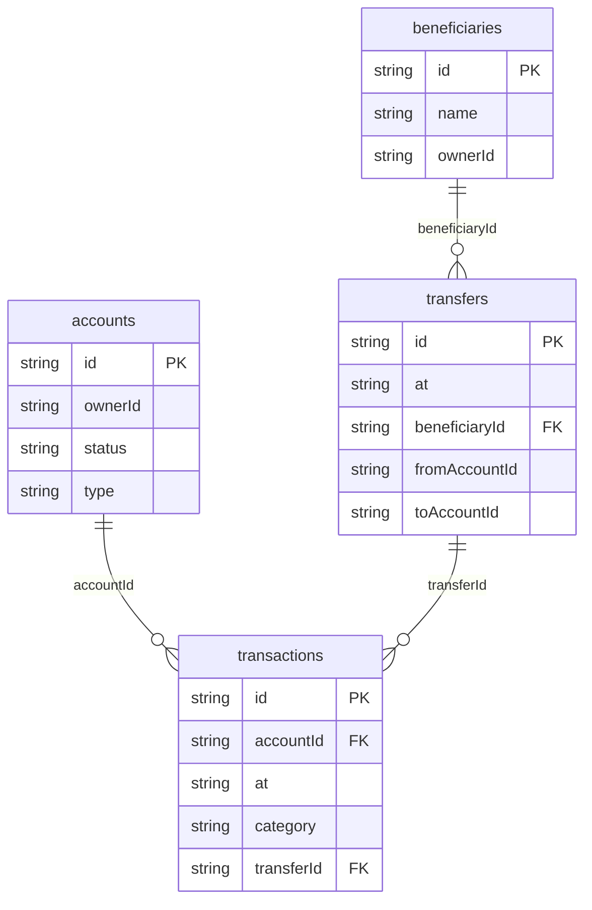

# Lumen Bank (fictional): data model

## Overview

A fictional household (the Rivera household) holds up to three accounts:
`acct_checking` (Everyday Checking), `acct_savings` (Rainy-day Savings) and
`acct_credit` (Lumen Card). Every change to a balance is a row in
`transactions`, and `accounts.balanceCents` always equals the sum of that
account's **posted** rows (`ledgerIsBalanced` in `src/domain/services.ts`
checks it; tests assert it after transfers and time advances). The generator
writes transactions first and derives balances from them, for the same
reason. A `transfers` row records who moved money where; its ledger rows point
back to it through `transactions.transferId`. `beneficiaries` are saved
external payees with display-only details. People, organizations and
memberships live in the platform tables (`py_personas` and the others), not in
domain tables.

## Tables

<!-- protoyard:generated:tables -->
| Table | Primary key | Indexes |
| --- | --- | --- |
| `accounts` | `id` (unique) | `ownerId`, `status`, `type` |
| `beneficiaries` | `id` (unique) | `name`, `ownerId` |
| `transactions` | `id` (unique) | `[accountId+at]` (compound), `accountId`, `at`, `category`, `transferId` |
| `transfers` | `id` (unique) | `at`, `beneficiaryId`, `fromAccountId`, `toAccountId` |
<!-- /protoyard:generated:tables -->

## Diagram

<!-- protoyard:generated:er-diagram -->

_Indexed fields only. Relations are inferred from indexed `…Id` fields that match a table name; describe the rest by hand._
<!-- /protoyard:generated:er-diagram -->

## Relations

Declared in `integrity.relations` in `src/prototype.ts`:

| Field | Points to | Cardinality |
| --- | --- | --- |
| `accounts.ownerId` | `py_personas.id` | a persona owns 0..n accounts (all generated accounts belong to `user_0001`) |
| `transactions.accountId` | `accounts.id` | an account has 0..n transactions |
| `transactions.transferId` | `transfers.id` (or null) | a transfer has 1 ledger row (to a payee) or 2 (between own accounts) |
| `beneficiaries.ownerId` | `py_personas.id` | a persona saved 0..n payees |
| `transfers.fromAccountId` | `accounts.id` | an account is the source of 0..n transfers |
| `transfers.toAccountId` | `accounts.id` (or null) | set for transfers between own accounts |
| `transfers.beneficiaryId` | `beneficiaries.id` (or null) | set for transfers to a payee; exactly one of `toAccountId` and `beneficiaryId` is set |
| `transfers.createdBy` | `py_personas.id` | the persona who sent it |

Removing a payee does not touch past transfers, so their `beneficiaryId` can
point to a deleted row.

## Field notes

- Money is integer cents in `accounts.balanceCents`,
  `accounts.dailyLimitCents`, `transactions.amountCents` and
  `transfers.amountCents`. `transactions.amountCents` is signed (negative =
  money out); `transfers.amountCents` is always positive. Currency is always
  `USD`.
- Dates are ISO 8601 strings: `accounts.openedAt`, `transactions.at`,
  `beneficiaries.createdAt`, `transfers.at`. Integrity checks timestamps on
  `transactions.at` and `beneficiaries.createdAt`.
- `accounts.type`: `checking`, `savings`, `credit`.
- `accounts.status`: `active`, `locked`, `dormant`. Only `active` accounts
  can send, receive transfers, take deposits or take timeline postings.
- `accounts.dailyLimitCents`: despite the name, a per-transfer cap checked by
  the transfer service (generated: checking 500,000, savings 1,000,000,
  credit 300,000). For a credit account it also sets the floor: the balance
  may go down to `-10 × dailyLimitCents`; checking and savings never go
  below 0.
- `transactions.category`: `groceries`, `dining`, `transport`, `shopping`,
  `utilities`, `rent`, `salary`, `transfer`, `entertainment`, `health`.
- `transactions.status`: `posted` (counts toward the balance) or `pending`
  (card authorisations; shown, but not part of the balance).
- `transfers.status`: `completed` or `failed`; only `completed` is ever
  written, because a failed transfer writes nothing.
- `accounts.masked` and `beneficiaries.masked` are display strings like
  `•••• 4821`; no full account number is stored. Payees keep the last 4
  digits only.
- Invariant: for every account, `balanceCents == sum(amountCents of posted
  transactions)`.

## Schema history

<!-- protoyard:generated:versions -->
| Version | Adds | Changes indexes | Deletes |
| --- | --- | --- | --- |
| 1 | `accounts`, `beneficiaries`, `transactions`, `transfers` | — | — |
<!-- /protoyard:generated:versions -->

## Migrations

There is one schema version (1) and no `upgrade` function, so there are no
migrations yet. A future version that changes a table must add a new entry
to `database.versions` in `src/database/schema.ts` with an `upgrade` that
keeps the ledger invariant.
