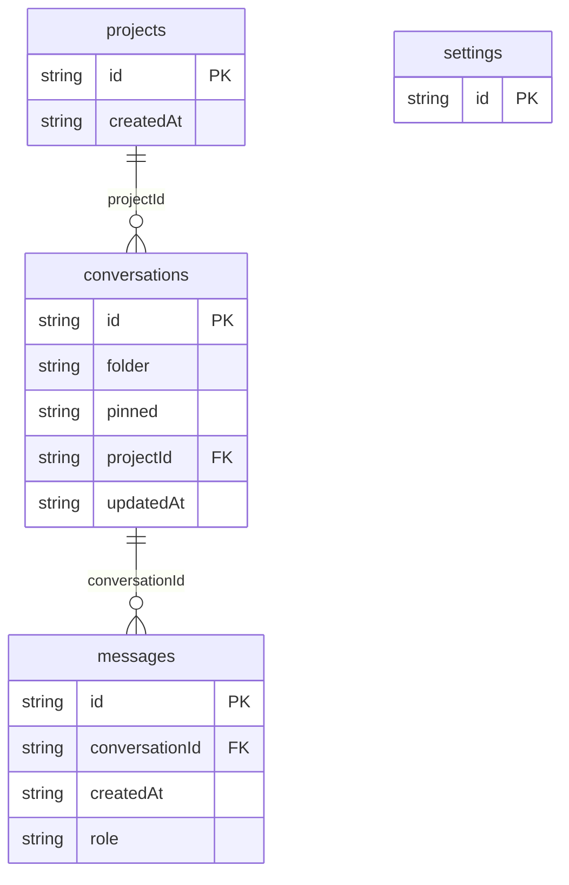

# Nova Assistant: data model

## Overview

Nova is one workspace in the browser. `projects` group conversations
(three per scenario: Product studio, Research, Personal).
`conversations` hold the title, the project, the selected model, a pin flag
and an optional folder; `messages` hold user prompts and assistant replies,
ordered by `createdAt`. A reply stores the model id and its simulated
`usage` (tokens and cost), which the usage meter and the monthly limit add
up. People are the platform personas (`py_personas`); messages do not
record which persona wrote them.

Workspace-wide state lives in a single `settings` row (id `workspace`):
custom instructions, memory, data controls, the monthly token limit, the
per-minute request limit, whether the agent needs approval, the canvas and
the folder names. Keeping it in one row makes the generator and the
settings form simple; a real product would split it.

The row types extend `AssistantConversation` and `AssistantMessage` from
`@protoyard/ai-ui` so the shared components can render them directly.

## Tables

<!-- protoyard:generated:tables -->
| Table | Primary key | Indexes |
| --- | --- | --- |
| `conversations` | `id` (unique) | `folder`, `pinned`, `projectId`, `updatedAt` |
| `messages` | `id` (unique) | `conversationId`, `createdAt`, `role` |
| `projects` | `id` (unique) | `createdAt` |
| `settings` | `id` (unique) | — |
<!-- /protoyard:generated:tables -->

## Diagram

<!-- protoyard:generated:er-diagram -->

_Indexed fields only. Relations are inferred from indexed `…Id` fields that match a table name; describe the rest by hand._
<!-- /protoyard:generated:er-diagram -->

## Relations

| From | To | Cardinality | Notes |
| --- | --- | --- | --- |
| `conversations.projectId` | `projects.id` | many to one | Checked by the integrity rules; `createConversation` checks the project exists |
| `messages.conversationId` | `conversations.id` | many to one | Checked by the integrity rules. Nothing deletes a conversation alone; `clearWorkspace` clears all three tables. |
| `conversations.folder` | an entry of `settings.folders` | many to one, by value | Not a key: `moveToFolder` checks the name exists. Folders cannot be removed. |
| `conversations.modelId`, `messages.model` | the model catalogue (`AI_MODELS` plus `py-orbit-agent`) | many to one, by value | Not stored in the database |
| `settings` | the workspace | exactly one row | Id `workspace`; services throw "Assistant workspace settings are missing." without it |

A user message and its reply share the same `createdAt`; the workspace
sorts ties with the user message first.

## Field notes

- **Dates:** `projects.createdAt`, `conversations.updatedAt`,
  `messages.createdAt` and `settings.updatedAt` are ISO 8601 strings from
  the simulation clock or the generator, never wall-clock time. The
  integrity rules check the first three in generated worlds.
- **`messages.role`:** `user` or `assistant`.
- **`messages.content`:** user prompts are trimmed, 1 to 8,000 characters.
  Replies grow while streaming and are rendered as safe rich text.
- **`messages.usage`:** on replies only: `promptTokens`, `completionTokens`,
  `totalTokens` (integers, estimated as `ceil(characters / 4)`) and
  `costUsd` (a float in US dollars from the model's fictional per-million
  prices; not integer cents, since nothing is charged). Generated history
  uses a fixed `costUsd` of 0.00002. A reply cut off by a reload has no
  `usage`.
- **`messages.feedback`:** `up` or `down`, on assistant replies only.
- **`messages.attachments`:** up to 8 file names; file contents are never
  stored.
- **`messages.branchIndex`, `branchCount`:** defined by the `@protoyard/ai-ui`
  type; this prototype never writes them.
- **`conversations.modelId`, `messages.model`:** `py-orbit-small` (default),
  `py-orbit-pro`, `py-orbit-long` or `py-orbit-agent`.
- **`conversations.title`:** `New conversation` when created; 2 to 80
  characters after a rename. Generated titles are three placeholder words.
- **`conversations.pinned`:** generated worlds pin the first conversation;
  **`conversations.folder`:** generated worlds put every third
  conversation in `Ideas`.
- **`settings.dataControls`:** `standard` or `private` (private leaves the
  memory out of the prompt).
- **`settings.monthlyLimit`:** integer tokens, 1,000 to 10,000,000 (default
  1,000,000). **`maxRequestsPerMinute`:** 30, or 2 in `rate-limited`; not
  editable in the UI.
- **`settings.agentApprovalRequired`:** `true` only in `agent-approval`.
- **`settings.canvas`:** `null` or `{ title, content, kind }` with kind
  `document` or `code` (content up to 20,000 characters through
  `updateCanvas`).
- **`settings.folders`:** generated as `Ideas` and `Launch`; names 1 to 40
  characters.
- **Ids:** generated rows use `ids.next` (`project`, `ai_conversation`,
  `ai_message` prefixes); runtime rows use `createRuntimeId` (`ai_chat`,
  `ai_user`, `ai_reply`).
- **Generator knobs:** `conversations`, `messagesPerConversation`
  (alternating user and assistant turns from fixed phrase lists),
  `approvals` (sets `agentApprovalRequired`) and `maxRequestsPerMinute`.
  `long-history` uses 5,000 messages two days apart, which is why its
  organization is 12,000 days old.

## Schema history

<!-- protoyard:generated:versions -->
| Version | Adds | Changes indexes | Deletes |
| --- | --- | --- | --- |
| 1 | `conversations`, `messages`, `projects`, `settings` | — | — |
<!-- /protoyard:generated:versions -->

## Migrations

None. Version 1 is the only schema version and has no `upgrade` function.
A change to the stores needs a new version in `src/database/schema.ts`; a
change to generated output needs a bump of `generatorVersion` in
`src/prototype.ts`.
