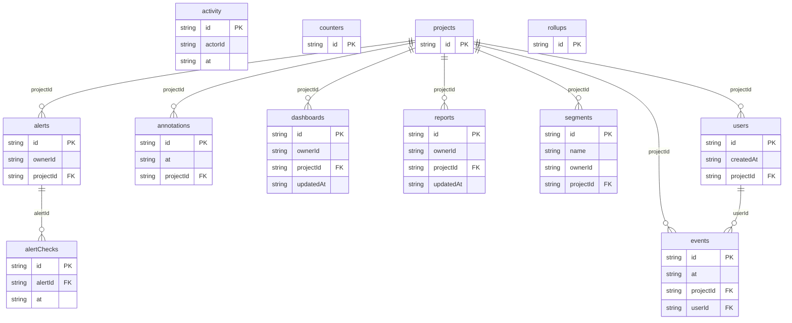

# Pebblestat Analytics: data model

## Overview

Pebblestat tracks **projects** (its products). Each project has tracked **users** who produce **events**: signups, page views, feature use and the activation steps. Events carry the user's properties (plan, country, platform), so filters and breakdowns need no join.

- **Sampled projects** (`sampleRate < 1`) store a user sample plus **rollups** (full-stream daily counts per type).
- The team saves **reports** (Trends queries), **segments** (filters), **dashboards** (grid layouts), **alerts** (daily thresholds, with the timeline's **alertChecks**) and **annotations** (release, incident and campaign notes).
- **activity** is the audit trail, and **counters** hold the live counter.

## Tables

<!-- protoyard:generated:tables -->
| Table | Primary key | Indexes |
| --- | --- | --- |
| `activity` | `id` (unique) | `actorId`, `at` |
| `alertChecks` | `id` (unique) | `alertId`, `at` |
| `alerts` | `id` (unique) | `ownerId`, `projectId` |
| `annotations` | `id` (unique) | `at`, `projectId` |
| `counters` | `id` (unique) | — |
| `dashboards` | `id` (unique) | `ownerId`, `projectId`, `updatedAt` |
| `events` | `id` (unique) | `[type+at]` (compound), `at`, `projectId`, `userId` |
| `projects` | `id` (unique) | — |
| `reports` | `id` (unique) | `ownerId`, `projectId`, `updatedAt` |
| `rollups` | `id` (unique) | `[projectId+day]` (compound) |
| `segments` | `id` (unique) | `name`, `ownerId`, `projectId` |
| `users` | `id` (unique) | `createdAt`, `projectId` |
<!-- /protoyard:generated:tables -->

## Diagram

<!-- protoyard:generated:er-diagram -->

_Indexed fields only. Relations are inferred from indexed `…Id` fields that match a table name; describe the rest by hand._
<!-- /protoyard:generated:er-diagram -->

## Relations

- `users.projectId`, `events.projectId`, `rollups.projectId`, `dashboards.projectId`, `segments.projectId`, `reports.projectId`, `alerts.projectId`, `alertChecks.projectId` and `annotations.projectId` → `projects.id` (project 1─* each).
- `events.userId` → `users.id` (user 1─* events; a user and their events share a project).
- `alertChecks.alertId` → `alerts.id` (alert 1─* checks; deleting an alert deletes its checks).
- `ownerId`, `authorId` and `actorId` → `py_personas`.

## Field notes

- **Timestamps:** ISO 8601 UTC strings; they sort by time, which the `at` indexes rely on. `rollups.day` is `YYYY-MM-DD` (UTC).
- **`projects.sampleRate`:** 1 for raw projects; 0.05 for Web in `enterprise-scale` (a 5 % user sample).
- **`events.type`:** one of `EVENT_TYPES`. `events.properties` is `{ plan, country, platform }`.
- **`reports.config`:** `{ eventType ('all' or a type), measure ('events' | 'users'), breakdown, filter }`, validated by `ReportInputSchema`.
- **`alerts`:**
  - `threshold` and `baseline` are daily event counts;
  - `operator` is `above` or `below`;
  - `status` is `firing` when the latest unmuted check crossed the threshold.
- **`annotations.at`:** noon UTC of the annotated day; it must not be in the future.

## Schema history

<!-- protoyard:generated:versions -->
| Version | Adds | Changes indexes | Deletes |
| --- | --- | --- | --- |
| 1 | `activity`, `alertChecks`, `alerts`, `annotations`, `counters`, `dashboards`, `events`, `projects`, `reports`, `rollups`, `segments`, `users` | — | — |
<!-- /protoyard:generated:versions -->

## Migrations

Version 1 is the first schema; there are no upgrades yet. Add a new version (never edit one) and bump `storage.schemaVersion` together.

