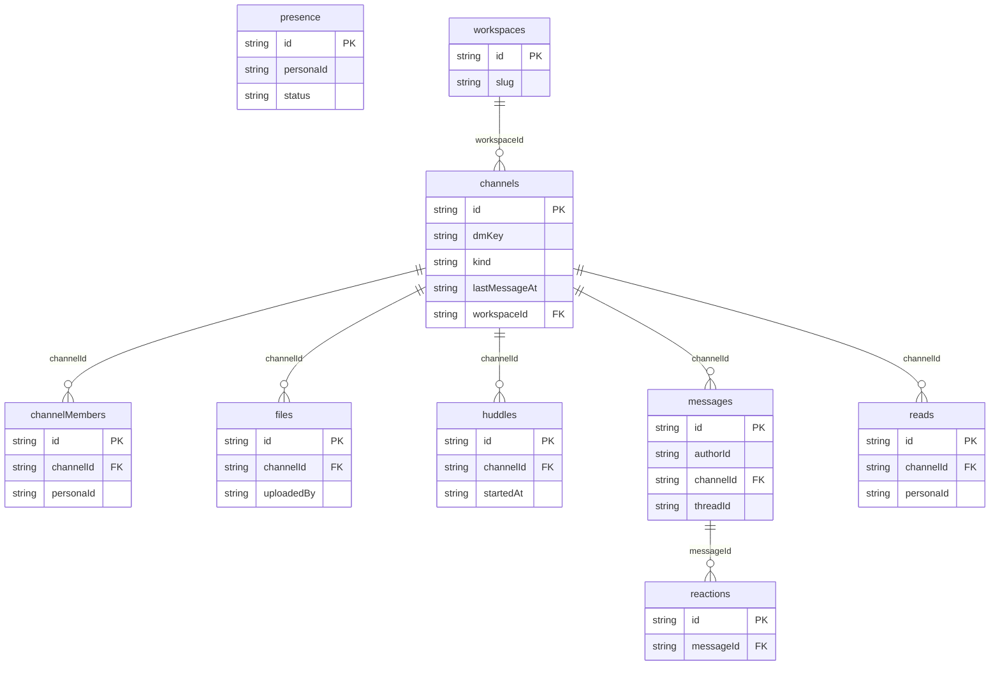

# Relay Chat: data model

## Overview

A **workspace** (one per world: "Relay Labs HQ", slug `relay-hq`) holds
**channels**. A channel is `public`, `private` or a `dm` between two
personas, and **channelMembers** records who has joined it. **Messages**
belong to a channel; a thread reply is a message whose `threadId` points at
its top-level parent. People react with **reactions** (one row per message,
persona and emoji), share **files** (metadata only) and hold **huddles**
(simulated calls with a caption log). **Presence** keeps the latest status
per persona, and **reads** keeps one read marker per channel and persona.

The model is flat and keyed by string ids so each screen query touches one
table. Rows that must be unique per combination use composite ids built by
helpers in `src/database/schema.ts` (`memberId`, `readMarkerId`,
`reactionId`, `presenceId`), so a `put` upserts and a reaction toggles by
id. The compound indexes (`[channelId+at]`, `[channelId+personaId]`,
`[messageId+personaId+emoji]`) are declared for these lookups, although
the current services query the single-field indexes and sort in memory.
Workspace identity (organization, personas, memberships) lives in the
reserved platform tables (`py_organizations`, `py_memberships`,
`py_personas`), not in this schema.

Seeded ids are deterministic (`channel_0001`, `msg_0004`); ids created in
the UI come from `createRuntimeId` (`msg`, `channel`, `dm`, `file`,
`huddle` prefixes).

## Tables

<!-- protoyard:generated:tables -->
| Table | Primary key | Indexes |
| --- | --- | --- |
| `channelMembers` | `id` (unique) | `[channelId+personaId]` (compound), `channelId`, `personaId` |
| `channels` | `id` (unique) | `dmKey`, `kind`, `lastMessageAt`, `workspaceId` |
| `files` | `id` (unique) | `channelId`, `uploadedBy` |
| `huddles` | `id` (unique) | `channelId`, `startedAt` |
| `messages` | `id` (unique) | `[channelId+at]` (compound), `authorId`, `channelId`, `threadId` |
| `presence` | `id` (unique) | `personaId`, `status` |
| `reactions` | `id` (unique) | `[messageId+personaId+emoji]` (compound), `messageId` |
| `reads` | `id` (unique) | `[channelId+personaId]` (compound), `channelId`, `personaId` |
| `workspaces` | `id` (unique) | `slug` |
<!-- /protoyard:generated:tables -->

## Diagram

<!-- protoyard:generated:er-diagram -->


_Indexed fields only. Relations are inferred from indexed `…Id` fields that match a table name; describe the rest by hand._
<!-- /protoyard:generated:er-diagram -->

## Relations

```text
py_organizations ─┬─ py_memberships ── py_personas      (platform identity tables)
                  │
workspaces 1─* channels 1─* messages 1─* reactions
                         │          └─ threadId → messages (parent, same channel; null at top level)
                         │          └─ fileId   → files (optional)
                         ├─* channelMembers *─1 py_personas
                         ├─* reads          *─1 py_personas
                         ├─* files          (uploadedBy → py_personas)
                         └─* huddles        (startedBy → py_personas)
presence 1─1 py_personas
messages.authorId → py_personas (authorKind 'person') | a bot id (authorKind 'bot')
```

`integrity.relations` in `src/prototype.ts` declares the references that
generated worlds are checked for: `channels.workspaceId`,
`channels.createdBy`, `channelMembers.channelId` and `.personaId`,
`messages.channelId`, `reactions.messageId` and `.personaId`,
`files.channelId` and `.uploadedBy`, `presence.personaId`,
`reads.channelId` and `.personaId`, `huddles.channelId` and `.startedBy`.
`messages.authorId`, `messages.threadId` and `messages.fileId` are not
declared: author ids include bot ids, which are not personas.

Nothing is ever deleted except reactions (toggled off). There is no
channel, message or file delete, so there are no cascades. The services do
not check that a `threadId` parent exists or is in the same channel.

## Field notes

- **Dates:** every timestamp (`createdAt`, `lastMessageAt`, `joinedAt`,
  `at`, `updatedAt`, `lastReadAt`, `startedAt`, `endedAt`) is an ISO 8601
  string from the simulated clock. Read markers and unread counts compare
  these strings directly.
- **`channels.kind`:** `public`, `private`, `dm`. `createChannel` accepts
  only `public` or `private` (the UI always creates `public`); `dm` comes
  from `openDm` or the generator. `dmKey` is `null` except for DMs, where it
  is the two persona ids sorted and joined with `:` (`dmKeyFor`), so one DM
  exists per pair.
- **`channels.name`:** 2–40 characters, lowercase letters, digits and
  dashes, starting with a letter or digit (DMs use the other persona's
  name). `topic` is at most 120 characters. Names are not unique.
- **`channels.lastMessageAt`:** updated whenever a message is posted
  (services and timeline); it orders the sidebar, newest first.
- **`channelMembers.role`:** `owner` or `member`. Id is
  `<channelId>:<personaId>`.
- **`messages.authorKind`:** `person` or `bot`. Bot author ids are
  `bot_relay`, `bot_standup`, `bot_ops` (`BOTS` in `src/domain/bots.ts`).
  `body` is 1–4,000 characters after trimming for person messages.
  `threadId` is the parent message id for replies, `null` at top level.
  `fileId` is set on "Shared …" messages.
- **`reactions`:** id `<messageId>:<personaId>:<emoji>`; `emoji` is trimmed
  and cut to 16 characters. Generated reactions use 👍, 🎉 or 👀; the UI
  only sends 👍.
- **`files.sizeBytes`:** integer bytes, 0–25,000,000. `mimeType` defaults
  to `application/octet-stream`. No file content is stored.
- **`presence.status`:** `online`, `away`, `offline`, `in-huddle`;
  `statusText` at most 80 characters when set through `setPresence`. Id is
  `presence:<personaId>`.
- **`reads`:** id `<channelId>:<personaId>`; `lastReadAt` is the last time
  that persona posted in or opened the channel.
- **`huddles.endedAt`:** `null` while active. At most one active huddle per
  channel (`startHuddle` returns the open one). `captions` is a
  newline-separated log of `<personaId>: <line>` entries.

Generated worlds (`src/scenarios/generators.ts`, version 1): three public
channels (`general`, `engineering`, `random`) with every persona as a member
(the actor as `owner`), one DM between the actor and another persona (not in
`empty`), 12 messages with reactions, two thread replies, bot lines and a
shared `sprint-plan.example.pdf` in `busy-day`, 4 messages in `quiet-night`
and `viewer`, and none in `empty`. Every persona gets a presence row and,
except in `empty`, a read marker at each channel's latest message.

## Schema history

<!-- protoyard:generated:versions -->
| Version | Adds | Changes indexes | Deletes |
| --- | --- | --- | --- |
| 1 | `channelMembers`, `channels`, `files`, `huddles`, `messages`, `presence`, `reactions`, `reads`, `workspaces` | — | — |
<!-- /protoyard:generated:versions -->

## Migrations

- **v1** creates all nine tables. No upgrade function; there are no later
  versions.

`storage.schemaVersion` in `protoyard.json` is 1 and must match the latest
entry of `database.versions`. A stored-row change needs a v2 with an
`upgrade` (see `crm-demo` for the reference example).
