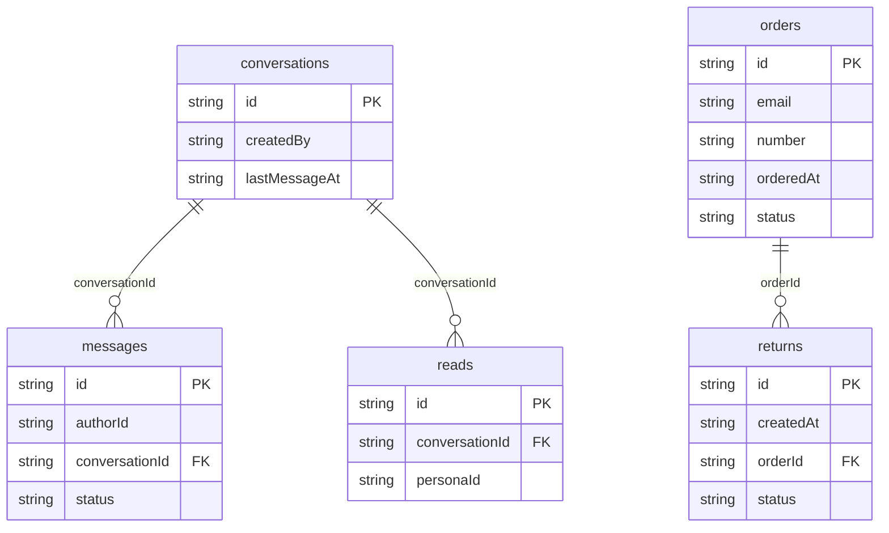

# Northwind Help: data model

## Overview

Northwind Help is one support thread per browser plus the store data the
assistant can talk about. People are the platform personas (`py_personas`,
a reserved platform table): the customer Alex Trail and the support agent
Casey Support. The scripted assistant is not a row anywhere: its messages
use the fixed author id `assistant`.

`conversations` normally holds a single row, `conv_support`, seeded by every
scenario (`SUPPORT_THREAD_ID` in `src/database/schema.ts`). Its
`messages` are read in order through the compound index
`[conversationId+at]`. An assistant reply streams into one `messages` row:
it is created empty with status `streaming` and its body grows chunk by
chunk, so a reload shows exactly what had arrived; `promptId` links it to
the message it answers. `reads` stores one read marker per conversation and
persona (id `<conversationId>:<personaId>`), which drives the launcher's
unread count.

`orders` are fictional store orders the visitor can look up, and `returns`
are return requests against them. They live in the same browser database
because there is no backend; in a real product they would come from the
store's order system.

## Tables

<!-- protoyard:generated:tables -->
| Table | Primary key | Indexes |
| --- | --- | --- |
| `conversations` | `id` (unique) | `createdBy`, `lastMessageAt` |
| `messages` | `id` (unique) | `[conversationId+at]` (compound), `authorId`, `conversationId`, `status` |
| `orders` | `id` (unique) | `email`, `number`, `orderedAt`, `status` |
| `reads` | `id` (unique) | `conversationId`, `personaId` |
| `returns` | `id` (unique) | `createdAt`, `orderId`, `status` |
<!-- /protoyard:generated:tables -->

## Diagram

<!-- protoyard:generated:er-diagram -->

_Indexed fields only. Relations are inferred from indexed `…Id` fields that match a table name; describe the rest by hand._
<!-- /protoyard:generated:er-diagram -->

## Relations

| From | To | Cardinality | Notes |
| --- | --- | --- | --- |
| `conversations.createdBy` | `py_personas.id` | many to one | Checked by the integrity rules in `src/prototype.ts` |
| `messages.conversationId` | `conversations.id` | many to one | Checked by the integrity rules. `send` does not check that the conversation exists. |
| `messages.authorId` | `py_personas.id`, or the literal `assistant` | many to one | `authorKind` (`person` or `assistant`) says which. The handoff message uses the fixed persona id `user_agent`. An unknown id shows as "Former member". |
| `messages.promptId` | `messages.id` | zero or one per message | Set on assistant replies to a visitor's message (generated history and live replies). `null` on the greeting, on people's messages and on return confirmations, which therefore cannot be retried. |
| `reads.conversationId`, `reads.personaId` | `conversations.id`, `py_personas.id` | one row per pair | The id is `<conversationId>:<personaId>` (`readMarkerId`), so `put` replaces it. Both relations are checked by the integrity rules. |
| `returns.orderId` | `orders.id` | many to one | The service allows a new return only when every earlier return on that order is `denied` (it checks the first one it finds). Checked by the integrity rules. |
| `returns.createdBy` | `py_personas.id` | many to one | Checked by the integrity rules; not indexed |
| `orders.email` | `py_personas.email` | many to one, by value | Not a foreign key: generated orders all use `alex.trail@example.com`. `listOrdersForEmail` matches on it. |

Nothing cascades: there is no service that deletes a conversation, order or
return.

## Field notes

- **Dates:** every timestamp (`createdAt`, `lastMessageAt`, `at`,
  `lastReadAt`, `orderedAt`, `shippedAt`, `updatedAt`) is an ISO 8601
  string from the simulation clock or the scenario generator, never
  wall-clock time. `shippedAt` is `null` for `processing` and `cancelled`
  orders. In generated worlds, the integrity rules require
  `conversations.createdAt`, `messages.at`, `orders.orderedAt` and
  `returns.createdAt` to lie between the organization's creation and the
  scenario's reference time.
- **Money:** `orders.totalCents` and `returns.amountCents` are integer cents
  (USD in the UI). A return amount is floored, at least 0 and at most the
  order total; the UI always requests the full total.
- **`messages.status`:** `sent`, `streaming` (being written, or cut off by a
  reload), `failed` (empty body, the reason in `error`) or `stopped` (the
  text that had arrived when the visitor pressed Stop).
- **`messages.authorKind`:** `person` or `assistant`.
- **`messages.body`:** trimmed, 1 to 4,000 characters for people. Rendered
  as plain text (`white-space: pre-wrap`), never as HTML.
- **`messages.at`:** always after the conversation's previous latest
  message (`nextAt`), because the simulation clock can be frozen.
- **`messages.error`:** `null` unless status is `failed`.
- **`conversations.handoffRequested`, `handoffJoined`:** booleans, both set to
  `true` together by `requestHandoff`; the UI reads only `handoffJoined`.
- **`conversations.title`:** `Support` for `conv_support`; 2 to 60
  characters through `createConversation`.
- **`orders.status`:** `processing`, `shipped`, `delivered` or `cancelled`.
  The generator cycles `delivered`, `shipped`, `processing`, `delivered`
  and never produces `cancelled`.
- **`orders.number`:** `NW-` plus `10040 + index` (`NW-10040`, `NW-10041`, …).
  `trackingCode` is `TRK` plus `100000 + index` when shipped, else `null`.
- **`orders.itemSummary`:** one of four catalogue items (Cascade 40L pack
  18,900¢, Ridge shell jacket 14,900¢, Trail mug 2,800¢, Summit poles
  8,500¢).
- **`returns.status`:** `requested`, `approved`, `received`, `refunded` or
  `denied`. Only `requested` is ever written; nothing moves a return
  forward. `reason` is trimmed, 3 to 200 characters.
- **Ids:** generated rows use `ids.next` (`msg`, `ord`, `ret` prefixes);
  runtime rows use `createRuntimeId` (`msg`, `ret`, `conv`). The support
  thread id is fixed: `conv_support`. Persona ids are fixed: `user_visitor`,
  `user_agent`.
- **Generator knobs:** `history` (0 to 6 prompt and reply pairs after the
  greeting), `orders` (0 to 6), `openReturn` (when above 0, one `requested`
  return on the first delivered order).

## Schema history

<!-- protoyard:generated:versions -->
| Version | Adds | Changes indexes | Deletes |
| --- | --- | --- | --- |
| 1 | `conversations`, `messages`, `orders`, `reads`, `returns` | — | — |
<!-- /protoyard:generated:versions -->

## Migrations

None. Version 1 is the only schema version and has no `upgrade` function.
A change to the stores needs a new version in `src/database/schema.ts`; a
change to generated output needs a bump of `generatorVersion` in
`src/prototype.ts`.
