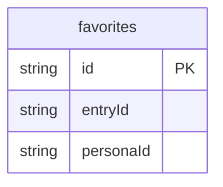

# Protoyard UI Kit: data model

## Overview

The kit's data is deliberately tiny: **favorites**, the catalog entries a
persona starred. Everything else the kit shows (components, groups,
patterns, usage snippets, accessibility notes) is static code in
`src/catalog/`, and every demo keeps its own state in memory. One domain
table is enough to show the full prototype pipeline (persistence per
persona, permissions, simulated failures, live queries and scenarios)
without inventing a business domain.

A favorite is one row per persona and entry. The `[personaId+entryId]`
compound index finds the row to delete on toggle; `personaId` drives the
per-persona list and `clear`. Persona identity lives in the reserved
platform tables (`py_organizations`, `py_memberships`, `py_personas`).
Custom themes and the theme override are not domain data: the runtime keeps
them in the prototype's control database.

Seeded ids are deterministic (`fav_0001`); ids created in the UI come from
`createRuntimeId('fav')`.

## Tables

<!-- protoyard:generated:tables -->
| Table | Primary key | Indexes |
| --- | --- | --- |
| `favorites` | `id` (unique) | `[personaId+entryId]` (compound), `entryId`, `personaId` |
<!-- /protoyard:generated:tables -->

## Diagram

<!-- protoyard:generated:er-diagram -->


_Indexed fields only. Relations are inferred from indexed `…Id` fields that match a table name; describe the rest by hand._
<!-- /protoyard:generated:er-diagram -->

## Relations

```text
py_personas 1─* favorites *─1 catalog entry (static, src/catalog/entries.ts)
```

- `favorites.personaId` → `py_personas.id`, declared in
  `integrity.relations` in `src/prototype.ts` so generated worlds are
  checked.
- `favorites.entryId` → `CATALOG[].id` in `src/catalog/entries.ts`. The
  catalog is code, not a table, so the database does not enforce it; the
  generator only picks real ids and the screens skip rows whose id is not in
  the catalog (the sidebar badge still counts them).
- At most one row per (`personaId`, `entryId`) when written through
  `toggle`. Nothing in the schema enforces the uniqueness.
- No cascades: there is no persona or entry delete.

## Field notes

- **`favorites.createdAt`:** an ISO 8601 string from the simulated clock;
  checked as a timestamp by `integrity.timestamps`. The Favorites page
  shows it as "starred today / yesterday / N days ago" against the
  simulated now, and lists the newest first.
- **`favorites.entryId`:** a catalog id, kebab-case (`button`,
  `pattern-kanban`); the service accepts 1–64 characters of `[a-z0-9-]`.
  The catalog has 54 entries in 11 groups (50 components and 4 patterns).
- **`favorites.personaId`:** always the acting persona at write time.
- **No money, enums or status fields.**

Generated worlds (`src/scenarios/generators.ts`; no `generatorVersion` is
set): one organization, "Protoyard Design", and two fixed personas, Dana
Reyes (`user_0001`, `designer`) and Sam Ito (`user_0002`, `viewer`), with
`example.com` emails. The `favorites` generator knob sets how many entries
the designer starred (a seeded sample of catalog ids, dated within the
organization's age); the viewer gets half as many. `default` and
`dark-viewer` use 6 (so 6 + 3 rows), `empty` uses 0.

## Schema history

<!-- protoyard:generated:versions -->
| Version | Adds | Changes indexes | Deletes |
| --- | --- | --- | --- |
| 1 | `favorites` | — | — |
<!-- /protoyard:generated:versions -->

## Migrations

- **v1** creates `favorites`. No upgrade function; there are no later
  versions.

`storage.schemaVersion` in `protoyard.json` is 1 and must match the latest
entry of `database.versions`.
