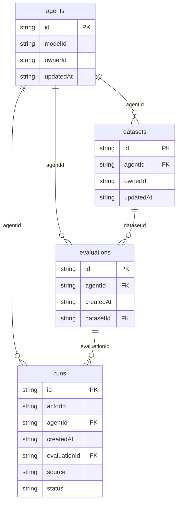

# Agent Console: data model

## Overview

TODO: the domain in words, and why the model looks this way.

## Tables

<!-- protoyard:generated:tables -->
| Table | Primary key | Indexes |
| --- | --- | --- |
| `agents` | `id` (unique) | `modelId`, `ownerId`, `updatedAt` |
| `datasets` | `id` (unique) | `agentId`, `ownerId`, `updatedAt` |
| `evaluations` | `id` (unique) | `agentId`, `createdAt`, `datasetId` |
| `runs` | `id` (unique) | `actorId`, `agentId`, `createdAt`, `evaluationId`, `source`, `status` |
<!-- /protoyard:generated:tables -->

## Diagram

<!-- protoyard:generated:er-diagram -->

_Indexed fields only. Relations are inferred from indexed `…Id` fields that match a table name; describe the rest by hand._
<!-- /protoyard:generated:er-diagram -->

## Relations

TODO: foreign keys and cardinalities the diagram cannot infer.

## Field notes

TODO: units (integer cents, ISO dates), enums and invariants.

## Schema history

<!-- protoyard:generated:versions -->
| Version | Adds | Changes indexes | Deletes |
| --- | --- | --- | --- |
| 1 | `agents`, `datasets`, `evaluations`, `runs` | — | — |
<!-- /protoyard:generated:versions -->

## Migrations

TODO: what each `upgrade` does to existing rows.
