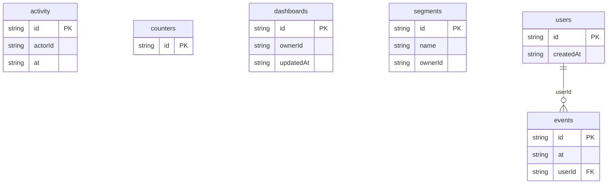

# Product Analytics: data model

## Overview

Tracked **users** of a fictional product produce **events** (signups, page views, feature use, the activation steps). Events carry the user's properties (plan, country, platform) so filters and breakdowns need no join.

The app's own people (personas) own **dashboards** (widget layouts on a 12-column grid) and **segments** (saved filters). **Counters** hold running values the timeline moves, and **activity** is the audit trail of edits.

## Tables

<!-- protoyard:generated:tables -->
| Table | Primary key | Indexes |
| --- | --- | --- |
| `activity` | `id` (unique) | `actorId`, `at` |
| `counters` | `id` (unique) | — |
| `dashboards` | `id` (unique) | `ownerId`, `updatedAt` |
| `events` | `id` (unique) | `[type+at]` (compound), `at`, `userId` |
| `segments` | `id` (unique) | `name`, `ownerId` |
| `users` | `id` (unique) | `createdAt` |
<!-- /protoyard:generated:tables -->

## Diagram

<!-- protoyard:generated:er-diagram -->

_Indexed fields only. Relations are inferred from indexed `…Id` fields that match a table name; describe the rest by hand._
<!-- /protoyard:generated:er-diagram -->

## Relations

- `events.userId` → `users.id` (user 1─* events)
- `dashboards.ownerId`, `segments.ownerId` → `py_personas` (persona 1─* dashboards, segments)
- `activity.actorId` → `py_personas`
- `counters.id` is a counter name (`active_users`), not a foreign key

## Field notes

- **Timestamps:** every instant is an ISO 8601 UTC string (`at`, `createdAt`, `updatedAt`). ISO strings sort by time, which the `at` and `[type+at]` indexes rely on.
- **`events.type`:** one of `EVENT_TYPES` (`signup`, `project_created`, `invite_sent`, `upgraded`, `page_view`, `feature_used`, `report_exported`).
- **`events.properties`:** `{ plan, country, platform }`; values are primitives only.
- **`dashboards.layout`:** validated by `DashboardLayoutSchema` (unique ids; widgets fit 12 columns).
- **`segments.filter`:** validated by `filterSchemaFor(EVENT_CATALOG)` (known properties only, operators that fit their type, at most 4 levels deep).
- **Invariants:** tracked users and events are never written by services. Each user's activation steps follow their signup in time.

## Schema history

<!-- protoyard:generated:versions -->
| Version | Adds | Changes indexes | Deletes |
| --- | --- | --- | --- |
| 1 | `activity`, `counters`, `dashboards`, `events`, `segments`, `users` | — | — |
<!-- /protoyard:generated:versions -->

## Migrations

Version 1 is the first schema; there are no upgrades yet. Add a new version (never edit one) and bump `storage.schemaVersion` together.
