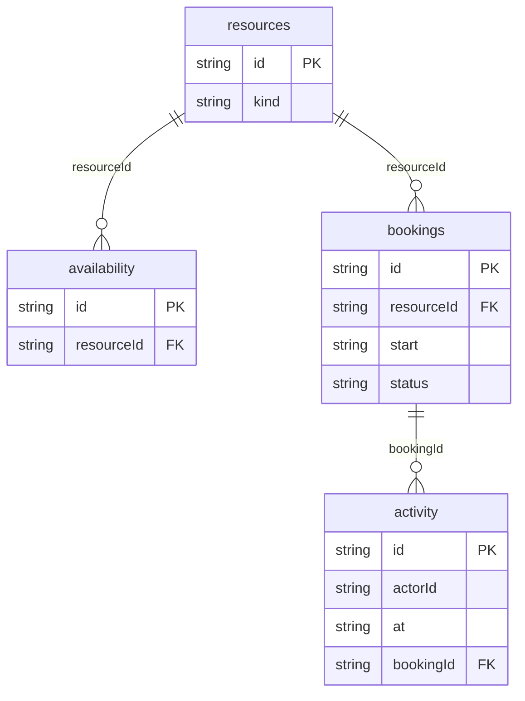

# Booking Calendar: data model

## Overview

Bookable **resources** (rooms and people) open on weekly **availability** rules (one row per resource and weekday, in UTC minutes). **Bookings** reserve a resource for a half-open UTC span and move through `confirmed` → `completed` / `no-show` (by time) or `cancelled` (by staff). **activity** is the audit trail of every change.

## Tables

<!-- protoyard:generated:tables -->
| Table | Primary key | Indexes |
| --- | --- | --- |
| `activity` | `id` (unique) | `actorId`, `at`, `bookingId` |
| `availability` | `id` (unique) | `[resourceId+weekday]` (compound), `resourceId` |
| `bookings` | `id` (unique) | `[resourceId+start]` (compound), `resourceId`, `start`, `status` |
| `resources` | `id` (unique) | `kind` |
<!-- /protoyard:generated:tables -->

## Diagram

<!-- protoyard:generated:er-diagram -->

_Indexed fields only. Relations are inferred from indexed `…Id` fields that match a table name; describe the rest by hand._
<!-- /protoyard:generated:er-diagram -->

## Relations

- `availability.resourceId` → `resources.id` (resource 1─* rules)
- `bookings.resourceId` → `resources.id` (resource 1─* bookings); `bookings.createdBy` → `py_personas`
- `activity.bookingId` → `bookings.id` (nullable, for opening-hour changes); `activity.actorId` → `py_personas`

## Field notes

- **Times:** `start`, `end`, `createdAt` and `updatedAt` are ISO 8601 UTC instants on a 15-minute grid. Spans are half-open `[start, end)`, between 15 minutes and 4 hours long.
- **`availability`:** `weekday` is 0 (Sunday) to 6 (UTC); `startMinute` and `endMinute` are minutes after UTC midnight, `startMinute < endMinute`.
- **`bookings.status`:** `confirmed`, `cancelled`, `completed` or `no-show`.
- **`bookings.source`:** `staff`, `public` or `block` (recurring internal blocks such as weekly cleaning).
- **Invariant:** two `confirmed` bookings of one resource never overlap, and each fits one availability rule of its day.

## Schema history

<!-- protoyard:generated:versions -->
| Version | Adds | Changes indexes | Deletes |
| --- | --- | --- | --- |
| 1 | `activity`, `availability`, `bookings`, `resources` | — | — |
<!-- /protoyard:generated:versions -->

## Migrations

Version 1 is the first schema; there are no upgrades yet. Add a new version (never edit one) and bump `storage.schemaVersion` together.
