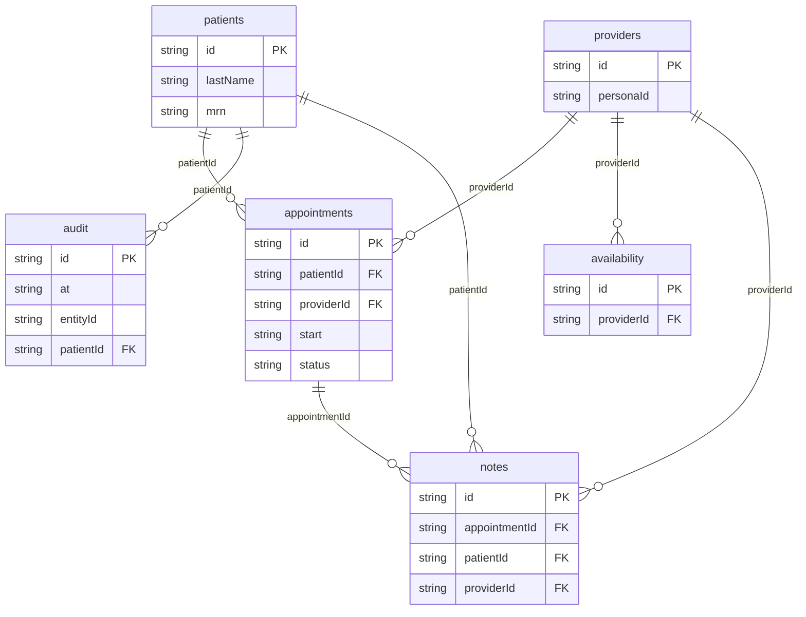

# Clinic: data model

## Overview

A small outpatient clinic, all fictional. Providers (clinicians) have
weekly clinic hours. The front desk registers patients and books them into
free provider time; on the day, patients are checked in, seen, and the
treating clinician writes and signs a plain-text visit note. Every change,
and every view of a patient's sensitive details, is appended to an audit log
that never contains a sensitive value.

The model keeps appointments and notes apart (a note exists only once the
patient arrives, and a signed note is final), and keeps the audit
append-only, so the log can be shown to a reviewer who may not see notes or
sensitive fields.

## Tables

<!-- protoyard:generated:tables -->
| Table | Primary key | Indexes |
| --- | --- | --- |
| `appointments` | `id` (unique) | `[providerId+start]` (compound), `patientId`, `providerId`, `start`, `status` |
| `audit` | `id` (unique) | `at`, `entityId`, `patientId` |
| `availability` | `id` (unique) | `[providerId+weekday]` (compound), `providerId` |
| `notes` | `id` (unique) | `appointmentId` (unique), `patientId`, `providerId` |
| `patients` | `id` (unique) | `lastName`, `mrn` (unique) |
| `providers` | `id` (unique) | `personaId` |
<!-- /protoyard:generated:tables -->

## Diagram

<!-- protoyard:generated:er-diagram -->

_Indexed fields only. Relations are inferred from indexed `…Id` fields that match a table name; describe the rest by hand._
<!-- /protoyard:generated:er-diagram -->

## Relations

- `providers.personaId` → `py_personas.id` (0..1): the persona who signs in
  as that clinician. Only that persona writes and signs the provider's notes.
- `appointments.createdBy` → `py_personas.id`: who booked it.
- `notes.appointmentId` is unique: one note per appointment at most.
- `notes.authorId` and `audit.actorId` → `py_personas.id`.
- `audit.entityId` points at a patient, appointment or note, by `entity`.
- Integrity checks for all of these are declared in `src/prototype.ts`.

## Field notes

- Every instant is an ISO 8601 UTC string. `patients.dateOfBirth` is a
  `YYYY-MM-DD` day, never in the future.
- `appointments.status`: `scheduled` → `checked-in` → `completed`, or
  `scheduled` → `cancelled` / `no-show`. Only `scheduled` and `checked-in`
  hold time. Check-in opens 60 minutes before `start` and closes at `end`.
- Appointment spans are half-open `[start, end)`, on 15-minute steps, at most
  2 hours, inside one `availability` rule of the provider. Neither a
  provider nor a patient has two overlapping appointments that hold time.
- `patients.mrn` is unique, `MRN-` and six digits, assigned in order.
- Sensitive fields (`SENSITIVE_PATIENT_FIELDS`): `dateOfBirth`, `phone`,
  `allergies`, `insuranceId`. Note `body` is treated as sensitive in the audit.
- `audit.changes[].from` / `to` hold `[redacted]` for every sensitive field.
- `notes.signedAt` set means final: the services refuse further edits.

## Schema history

<!-- protoyard:generated:versions -->
| Version | Adds | Changes indexes | Deletes |
| --- | --- | --- | --- |
| 1 | `appointments`, `audit`, `availability`, `notes`, `patients`, `providers` | — | — |
<!-- /protoyard:generated:versions -->

## Migrations

None yet: version 1 is the first schema. A future version adds a NEW
`versions` entry in `src/database/schema.ts`, bumps `storage.schemaVersion`,
and describes its `upgrade` here.
