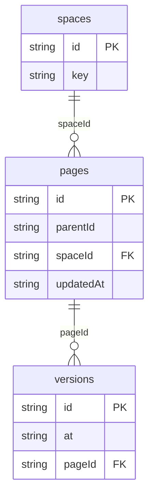

# Docs Wiki: data model

## Overview

A wiki of fictional team docs. Spaces group pages; inside a space, pages
form a tree through `parentId` and a fractional `rank` among siblings.
A page holds its current title and Markdown body plus a `version` counter.
Every save, creation and restore appends a full copy to `versions`, so any
state can be shown or restored without diffs or replays.

## Tables

<!-- protoyard:generated:tables -->
| Table | Primary key | Indexes |
| --- | --- | --- |
| `pages` | `id` (unique) | `parentId`, `spaceId`, `updatedAt` |
| `spaces` | `id` (unique) | `key` (unique) |
| `versions` | `id` (unique) | `[pageId+version]` (unique, compound), `at`, `pageId` |
<!-- /protoyard:generated:tables -->

## Diagram

<!-- protoyard:generated:er-diagram -->

_Indexed fields only. Relations are inferred from indexed `…Id` fields that match a table name; describe the rest by hand._
<!-- /protoyard:generated:er-diagram -->

## Relations

- `pages.parentId` → `pages.id` (0..1), always in the same space; `null` is a top-level page.
- `versions.pageId` → `pages.id` (1..*); `[pageId+version]` is unique.
- `pages.createdBy`, `pages.updatedBy` and `versions.authorId` → `py_personas.id`.
- Deleting a page deletes its versions in the same transaction; pages with
  children cannot be deleted.

## Field notes

- Instants are ISO 8601 UTC strings.
- `pages.version` equals the highest `versions.version` of the page, and that
  version's `title` and `body` equal the page's.
- `versions.note` is `Created`, `Edited` or `Restored vN`.
- `pages.body` is Markdown source of at most 50,000 characters; titles at most 120.
- `spaces.key` is unique, 2–10 upper-case letters or digits.
- `rank` strings sort by code unit (never `localeCompare`) and are unique among siblings.

## Schema history

<!-- protoyard:generated:versions -->
| Version | Adds | Changes indexes | Deletes |
| --- | --- | --- | --- |
| 1 | `pages`, `spaces`, `versions` | — | — |
<!-- /protoyard:generated:versions -->

## Migrations

None yet: version 1 is the first schema. A future version adds a NEW
`versions` entry in `src/database/schema.ts`, bumps `storage.schemaVersion`,
and describes its `upgrade` here.
