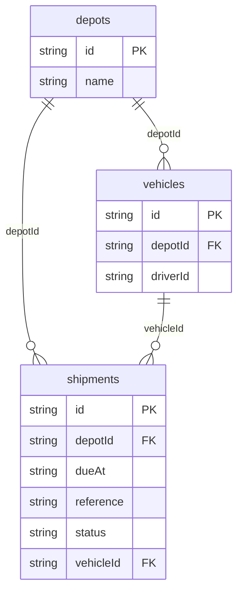

# Logistics Map: data model

## Overview

The dispatch model keeps depot, vehicle and shipment records separate so
assignments can be validated against a vehicle's home depot. A shipment stores
its deterministic route stops and planned arrival; its live position and ETA
are derived at read time from the simulated clock.

## Tables

<!-- protoyard:generated:tables -->
| Table | Primary key | Indexes |
| --- | --- | --- |
| `depots` | `id` (unique) | `name` |
| `shipments` | `id` (unique) | `[status+dueAt]` (compound), `depotId`, `dueAt`, `reference`, `status`, `vehicleId` |
| `vehicles` | `id` (unique) | `depotId`, `driverId` |
<!-- /protoyard:generated:tables -->

## Diagram

<!-- protoyard:generated:er-diagram -->

_Indexed fields only. Relations are inferred from indexed `…Id` fields that match a table name; describe the rest by hand._
<!-- /protoyard:generated:er-diagram -->

## Relations

Each vehicle belongs to one depot and references one seeded persona as its
driver. Each shipment belongs to a depot and may reference a vehicle. Its route
is an ordered list of fictional latitude/longitude pairs; it is not a real
street route.

## Field notes

`capacity` is a count of parcels. Locations are `{ lat, lng }` degrees.
`status` is `ready`, `in-transit` or `delivered`; only a ready shipment may be
dispatched, and only an in-transit shipment may be reassigned. `createdAt`,
`dispatchedAt` and `dueAt` are ISO timestamps.

## Schema history

<!-- protoyard:generated:versions -->
| Version | Adds | Changes indexes | Deletes |
| --- | --- | --- | --- |
| 1 | `depots`, `shipments`, `vehicles` | — | — |
<!-- /protoyard:generated:versions -->

## Migrations

Version 1 creates all stores; there are no prior rows to migrate.
