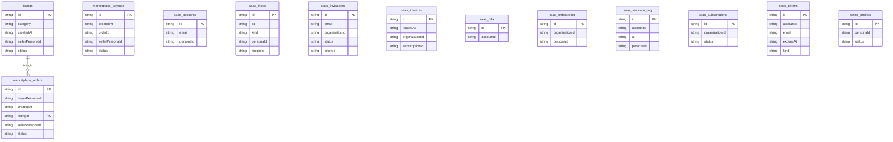

# Marketplace: data model

## Overview

TODO: the domain in words, and why the model looks this way.

## Tables

<!-- protoyard:generated:tables -->
| Table | Primary key | Indexes |
| --- | --- | --- |
| `listings` | `id` (unique) | `category`, `createdAt`, `sellerPersonaId`, `status` |
| `marketplace_orders` | `id` (unique) | `buyerPersonaId`, `createdAt`, `listingId`, `sellerPersonaId`, `status` |
| `marketplace_payouts` | `id` (unique) | `createdAt`, `orderId`, `sellerPersonaId`, `status` |
| `saas_accounts` | `id` (unique) | `email` (unique), `personaId` |
| `saas_inbox` | `id` (unique) | `at`, `kind`, `personaId`, `recipient` |
| `saas_invitations` | `id` (unique) | `email`, `organizationId`, `status`, `tokenId` |
| `saas_invoices` | `id` (unique) | `issuedAt`, `organizationId`, `subscriptionId` |
| `saas_mfa` | `id` (unique) | `accountId` (unique) |
| `saas_onboarding` | `id` (unique) | `organizationId`, `personaId` |
| `saas_sessions_log` | `id` (unique) | `accountId`, `at`, `personaId` |
| `saas_subscriptions` | `id` (unique) | `organizationId`, `status` |
| `saas_tokens` | `id` (unique) | `accountId`, `email`, `expiresAt`, `kind` |
| `seller_profiles` | `id` (unique) | `personaId`, `status` |
<!-- /protoyard:generated:tables -->

## Diagram

<!-- protoyard:generated:er-diagram -->

_Indexed fields only. Relations are inferred from indexed `…Id` fields that match a table name; describe the rest by hand._
<!-- /protoyard:generated:er-diagram -->

## Relations

TODO: foreign keys and cardinalities the diagram cannot infer.

## Field notes

TODO: units (integer cents, ISO dates), enums and invariants.

## Schema history

<!-- protoyard:generated:versions -->
| Version | Adds | Changes indexes | Deletes |
| --- | --- | --- | --- |
| 1 | `listings`, `marketplace_orders`, `marketplace_payouts`, `saas_accounts`, `saas_inbox`, `saas_invitations`, `saas_invoices`, `saas_mfa`, `saas_onboarding`, `saas_sessions_log`, `saas_subscriptions`, `saas_tokens`, `seller_profiles` | — | — |
<!-- /protoyard:generated:versions -->

## Migrations

TODO: what each `upgrade` does to existing rows.
