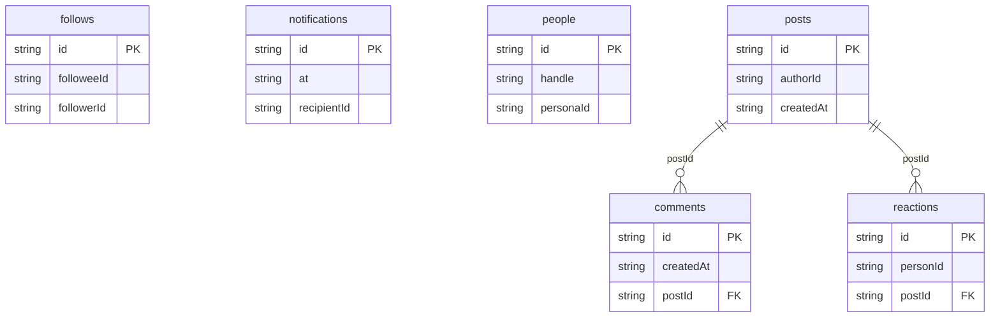

# Social Feed: data model

## Overview

**People** form the network. Three are personas of this app, the rest are simulated members. They write **posts**, which have optional placeholder **media**, **reactions** (one per person per post) and **comments**. **Follows** connect people; the Home timeline is your posts and those of the people you follow. **Notifications** tell a person about reactions, comments, follows and mentions aimed at them.

Reaction and comment counts are stored on each post, so a feed of thousands of posts renders without counting rows.

## Tables

<!-- protoyard:generated:tables -->
| Table | Primary key | Indexes |
| --- | --- | --- |
| `comments` | `id` (unique) | `createdAt`, `postId` |
| `follows` | `id` (unique) | `[followerId+followeeId]` (unique, compound), `followeeId`, `followerId` |
| `notifications` | `id` (unique) | `at`, `recipientId` |
| `people` | `id` (unique) | `handle` (unique), `personaId` |
| `posts` | `id` (unique) | `authorId`, `createdAt` |
| `reactions` | `id` (unique) | `[postId+personId]` (compound), `personId`, `postId` |
<!-- /protoyard:generated:tables -->

## Diagram

<!-- protoyard:generated:er-diagram -->

_Indexed fields only. Relations are inferred from indexed `…Id` fields that match a table name; describe the rest by hand._
<!-- /protoyard:generated:er-diagram -->

## Relations

- `posts.authorId`, `comments.authorId`, `reactions.personId` → `people.id`
- `reactions.postId`, `comments.postId` → `posts.id` (deleting a post deletes them, and its notifications)
- `follows.followerId`, `follows.followeeId` → `people.id`, unique per pair (`&[followerId+followeeId]`)
- `notifications.recipientId`, `actorId` → `people.id`; `notifications.postId` → `posts.id` (nullable for follows)
- `people.personaId` → `py_personas` (nullable for simulated members); `people.handle` is unique

## Field notes

- **Timestamps:** ISO 8601 UTC strings; timelines sort by `createdAt` (newest first, ties by id).
- **Text:** plain text, 1–500 characters for posts and 1–300 for comments, trimmed, with three or more blank lines collapsed to one blank line.
- **Reactions:** `like`, `celebrate` or `insightful`.
- **Notifications:** `kind` is `reaction`, `comment`, `follow` or `mention`. `read` is a boolean, which IndexedDB cannot index, so unread filters run over the recipient's rows.
- **Media:** `{ kind: 'image', hue, alt }`, a generated gradient; never a file or URL.
- **Invariant:** `reactionCounts` and `commentCount` equal the rows (tested for every scenario).

## Schema history

<!-- protoyard:generated:versions -->
| Version | Adds | Changes indexes | Deletes |
| --- | --- | --- | --- |
| 1 | `comments`, `follows`, `notifications`, `people`, `posts`, `reactions` | — | — |
<!-- /protoyard:generated:versions -->

## Migrations

Version 1 is the first schema; there are no upgrades yet. Add a new version (never edit one) and bump `storage.schemaVersion` together.
