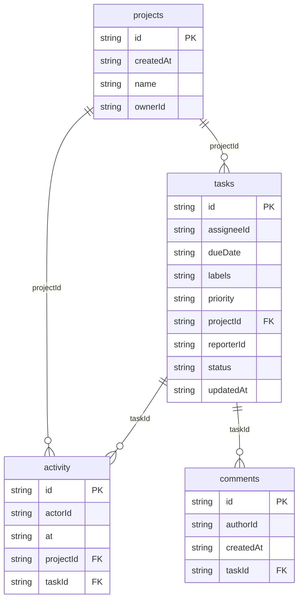

# Task Manager: data model

## Overview

TODO: the domain in words, and why the model looks this way.

## Tables

<!-- protoyard:generated:tables -->
| Table | Primary key | Indexes |
| --- | --- | --- |
| `activity` | `id` (unique) | `actorId`, `at`, `projectId`, `taskId` |
| `comments` | `id` (unique) | `authorId`, `createdAt`, `taskId` |
| `projects` | `id` (unique) | `createdAt`, `name`, `ownerId` |
| `tasks` | `id` (unique) | `assigneeId`, `dueDate`, `labels` (multi-entry), `priority`, `projectId`, `reporterId`, `status`, `updatedAt` |
<!-- /protoyard:generated:tables -->

## Diagram

<!-- protoyard:generated:er-diagram -->

_Indexed fields only. Relations are inferred from indexed `…Id` fields that match a table name; describe the rest by hand._
<!-- /protoyard:generated:er-diagram -->

## Relations

TODO: foreign keys and cardinalities the diagram cannot infer.

## Field notes

TODO: units (integer cents, ISO dates), enums and invariants.

## Schema history

<!-- protoyard:generated:versions -->
| Version | Adds | Changes indexes | Deletes |
| --- | --- | --- | --- |
| 1 | `activity`, `comments`, `projects`, `tasks` | — | — |
<!-- /protoyard:generated:versions -->

## Migrations

TODO: what each `upgrade` does to existing rows.
