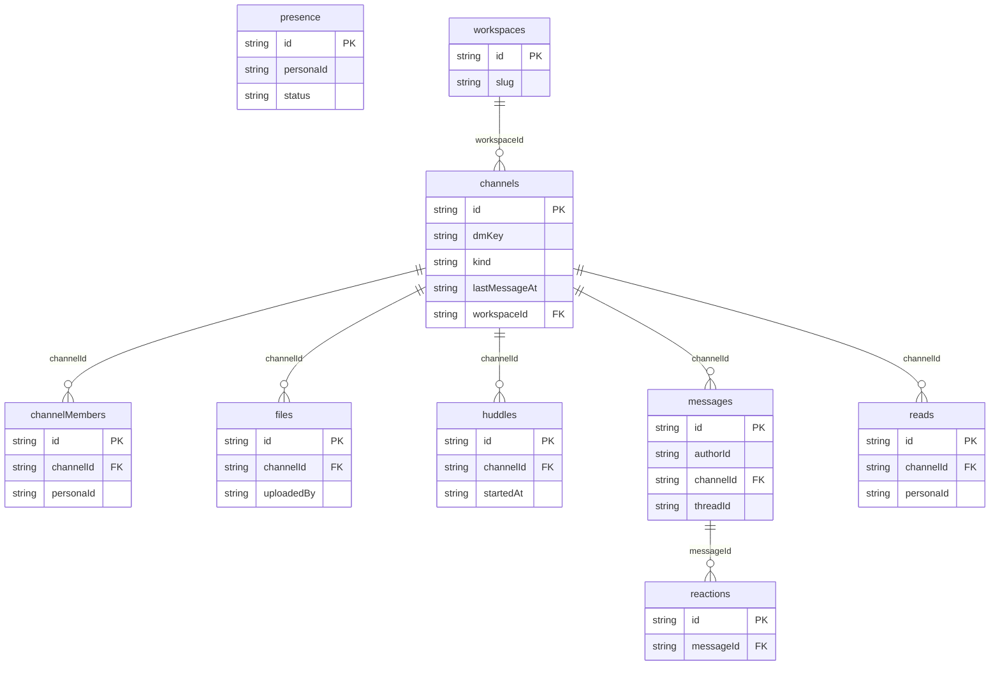

# Team chat: data model

## Overview

TODO: the domain in words, and why the model looks this way.

## Tables

<!-- protoyard:generated:tables -->
| Table | Primary key | Indexes |
| --- | --- | --- |
| `channelMembers` | `id` (unique) | `[channelId+personaId]` (compound), `channelId`, `personaId` |
| `channels` | `id` (unique) | `dmKey`, `kind`, `lastMessageAt`, `workspaceId` |
| `files` | `id` (unique) | `channelId`, `uploadedBy` |
| `huddles` | `id` (unique) | `channelId`, `startedAt` |
| `messages` | `id` (unique) | `[channelId+at]` (compound), `authorId`, `channelId`, `threadId` |
| `presence` | `id` (unique) | `personaId`, `status` |
| `reactions` | `id` (unique) | `[messageId+personaId+emoji]` (compound), `messageId` |
| `reads` | `id` (unique) | `[channelId+personaId]` (compound), `channelId`, `personaId` |
| `workspaces` | `id` (unique) | `slug` |
<!-- /protoyard:generated:tables -->

## Diagram

<!-- protoyard:generated:er-diagram -->

_Indexed fields only. Relations are inferred from indexed `…Id` fields that match a table name; describe the rest by hand._
<!-- /protoyard:generated:er-diagram -->

## Relations

TODO: foreign keys and cardinalities the diagram cannot infer.

## Field notes

TODO: units (integer cents, ISO dates), enums and invariants.

## Schema history

<!-- protoyard:generated:versions -->
| Version | Adds | Changes indexes | Deletes |
| --- | --- | --- | --- |
| 1 | `channelMembers`, `channels`, `files`, `huddles`, `messages`, `presence`, `reactions`, `reads`, `workspaces` | — | — |
<!-- /protoyard:generated:versions -->

## Migrations

TODO: what each `upgrade` does to existing rows.
